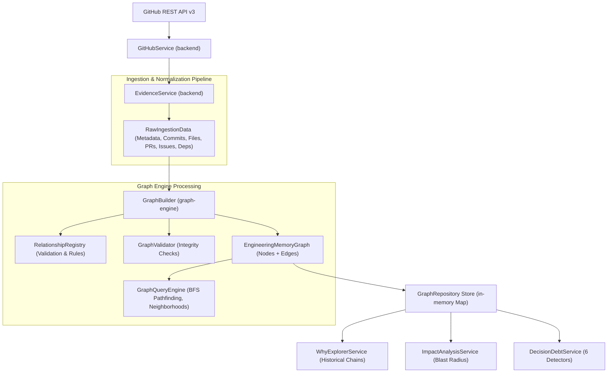
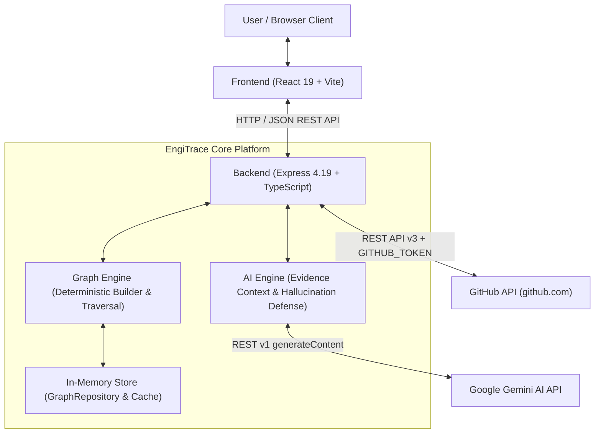
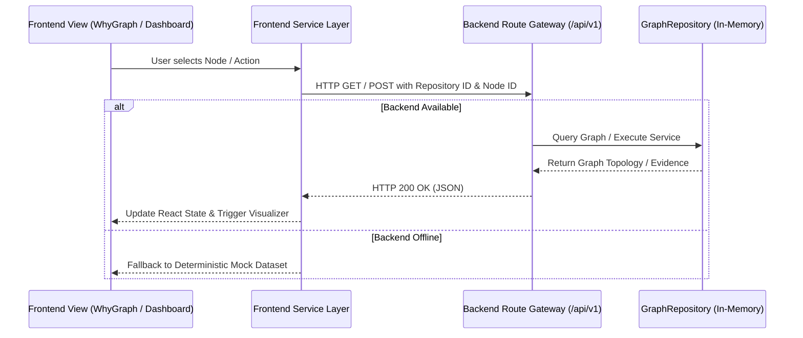
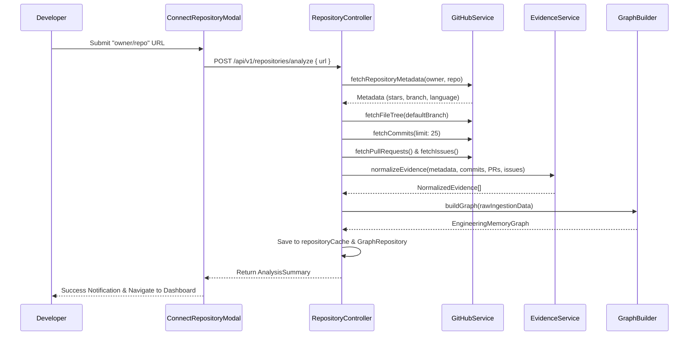
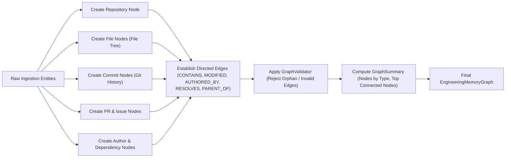
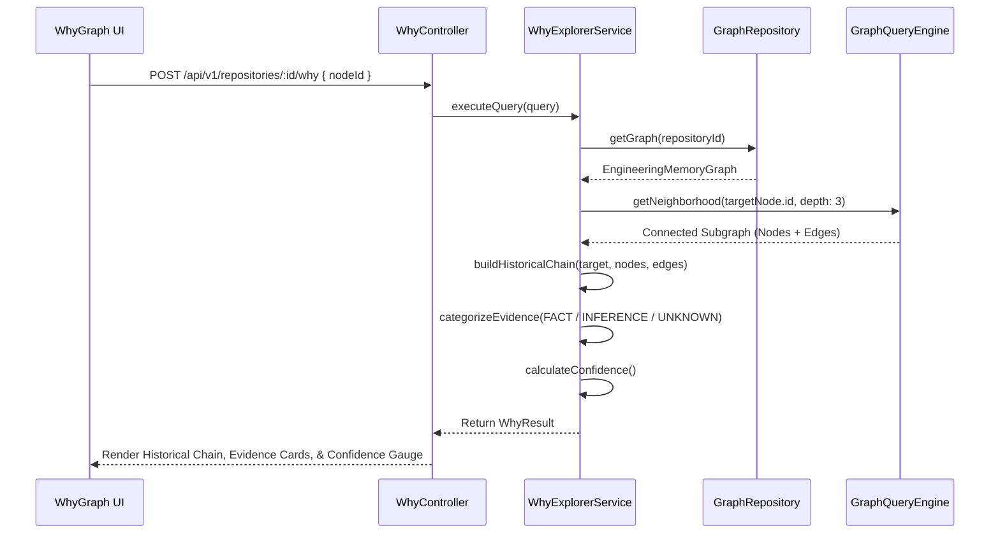
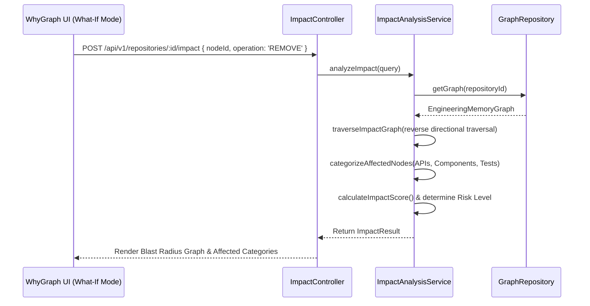
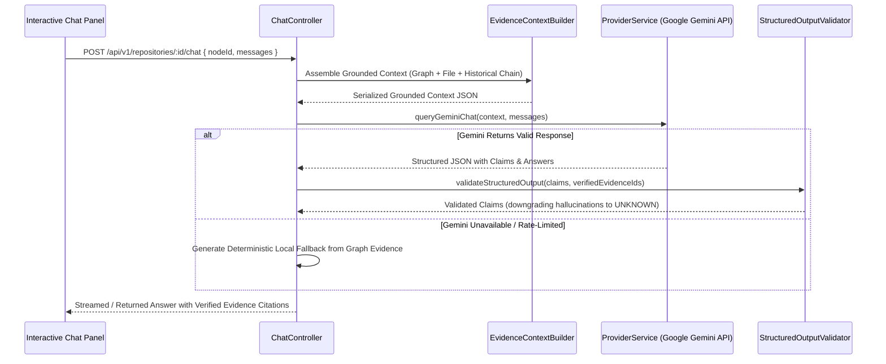

# EngiTrace — Engineering Memory & Architectural Intelligence Platform
## Complete Technical Audit and System Architecture Documentation

**Product Name:** EngiTrace *(Formerly CodeOrigin)*  
**Product Subtitle:** Engineering Intelligence  
**Document Status:** Verified against source code  
**Auditor:** Senior Software Architect & Technical Lead  
**Audit Date:** November 2026  
**Primary Deliverable File:** `docs/ENGITRACE_PROJECT_SUMMARY.md` (and historical `docs/CODEORIGIN_PROJECT_SUMMARY.md`)  

---

## Table of Contents

1. [Part 1: Project Overview](#part-1-project-overview)
2. [Part 2: Complete Technology Stack](#part-2-complete-technology-stack)
3. [Part 3: Project Directory Structure](#part-3-project-directory-structure)
4. [Part 4: Frontend Architecture](#part-4-frontend-architecture)
5. [Part 5: Backend Architecture](#part-5-backend-architecture)
6. [Part 6: Graph Engine and Analyzer](#part-6-graph-engine-and-analyzer)
7. [Part 7: AI Engine](#part-7-ai-engine)
8. [Part 8: Core EngiTrace Features](#part-8-core-engitrace-features)
9. [Part 9: Data Flow and System Architecture](#part-9-data-flow-and-system-architecture)
10. [Part 10: Environment and Configuration](#part-10-environment-and-configuration)
11. [Part 11: Development and Execution](#part-11-development-and-execution)
12. [Part 12: Current Project Status and Known Issues](#part-12-current-project-status-and-known-issues)
13. [Part 13: Technical Debt and Improvement Opportunities](#part-13-technical-debt-and-improvement-opportunities)
14. [Part 14: Homepage Visual Implementation Report](#part-14-homepage-visual-implementation-report)
15. [Part 15: Final Executive Summary](#part-15-final-executive-summary)

---

# Part 1: Project Overview

### 1. What EngiTrace Does
EngiTrace is a specialized software archaeology and engineering intelligence platform. It reconstructs the **historical architectural reasoning** behind complex codebases by deterministically linking source code files, Git commits, pull requests, issues, and external dependencies into an **Engineering Memory Graph**. Rather than simply inspecting static code syntax, EngiTrace answers developer questions regarding *why* code was designed in a particular way, *what* outage or ticket motivated a legacy change, and *what* downstream blast radius will occur if a module or interface is altered.

### 2. Primary Problem It Aims to Solve
In modern software engineering, institutional knowledge evaporates rapidly due to team turnover, forgotten decisions, undocumented hotfixes, and tribal knowledge. Developers frequently encounter legacy code blocks with no context:
- Traditional code search tools (e.g., `git blame`) only answer **who** touched a line and **when**, not **why** the architectural tradeoff was accepted.
- Documentation and architecture decision records (ADRs) quickly become stale, drifting away from production realities.
- Refactoring legacy code introduces high regression risks because developers cannot foresee implicit dependencies across issues, outages, and past incident post-mortems.

EngiTrace bridges this gap by grounding engineering context in deterministic Git and GitHub evidence, verified by an integrated AI reasoning engine.

### 3. Main Functionalities
- **GitHub Ingestion Pipeline**: Ingests public and private repositories, extracts commits, commit file diffs, pull requests, issues, and package manifests, and normalizes them into structured evidence records.
- **Engineering Memory Graph (WhyGraph™)**: Builds a directed, typed graph connecting repositories, files, commits, PRs, issues, dependencies, and author entities.
- **WHY Explorer**: Explores historical chains behind any file, commit, or component, categorizing every claim into `FACT`, `INFERENCE`, or `UNKNOWN`.
- **WHAT-IF Impact Analysis**: Performs directional graph traversals to calculate downstream blast radius, affected APIs, impacted unit tests, and risk severity scores (`LOW`, `MEDIUM`, `HIGH`, `CRITICAL`).
- **Decision Debt Scoring**: Runs 6 deterministic detectors over the graph to identify undocumented hotfixes, historical fragmentation, obsolete dependencies, and rationale drift.
- **Evidence-Grounded AI Reasoning**: Direct Google Gemini API integration that answers developer inquiries without hallucination, enforcing an anti-hallucination defense layer that downgrades unsupported claims.

### 4. Intended Users
- **Senior Software Engineers & Architects**: Investigating legacy systems, planning major refactors, or conducting architectural reviews.
- **Tech Leads & Engineering Managers**: Auditing architectural drift, measuring decision debt, and accelerating new developer onboarding.
- **Platform & SRE Teams**: Tracing incident root causes back to historical commits and pull requests.
- **New Hires**: Rapidly understanding *why* a repository was built with specific patterns without interrupting senior teammates.

### 5. Implementation Status
The application is currently functional in a **hybrid live-API and fallback architecture**. Core algorithms (Graph construction, BFS pathfinding, WHY chain reconstruction, Impact scoring, Decision Debt signal detection, and Gemini chat reasoning) are **fully implemented in TypeScript**. When running without a backend or live GitHub/Gemini keys, the frontend gracefully falls back to deterministic mock datasets.

### 6. Feature Implementation Status Breakdown
- **GitHub Repository Ingestion**: Fully Implemented (`backend/src/services/githubService.ts`).
- **Engineering Memory Graph**: Fully Implemented (`graph-engine/src/`).
- **WHY Explorer Service**: Fully Implemented (`backend/src/services/whyExplorerService.ts`).
- **WHAT-IF Impact Analysis**: Fully Implemented (`backend/src/services/impactAnalysisService.ts`).
- **Decision Debt Signal Engine**: Fully Implemented (`backend/src/services/decision-debt/decisionDebtDetectors.ts`).
- **AI Reasoning & Gemini Integration**: Fully Implemented (`ai-engine/services/providerService.ts`).
- **Interactive Multi-Mode Graph Visualizer**: Fully Implemented (`frontend/src/pages/WhyGraph/WhyGraphPage.tsx`).
- **Repository Management UI**: Fully Implemented (`frontend/src/pages/Repository/Repository.tsx`).
- **Database Persistence (Neo4j / PostgreSQL)**: Not Implemented (Currently in-memory `Map` storage in `GraphRepository`).
- **GitHub OAuth Login**: Not Implemented (Uses Personal Access Token `GITHUB_TOKEN`).
- **Analyzer AST/Symbol Parsing**: Partially Implemented (`analyzer/src/index.ts` is currently a Phase 0 scaffold; file-level analysis is implemented in `githubService.ts` and `graphBuilder.ts`).
- **Interactive ADR Creator**: UI Only (`frontend/src/pages/Decisions/DecisionsPage.tsx` uses mock data).
- **Time Machine Scrubber**: UI Only (`frontend/src/pages/Timeline/TimelinePage.tsx` uses mock timeline data).

---

# Part 2: Complete Technology Stack

### Frontend
- **Framework & Version**: React `19.0.0` with `react-dom` `19.0.0`.
- **Build Tool & Bundler**: Vite `6.1.1` with `@vitejs/plugin-react` `4.3.4`.
- **Programming Language**: TypeScript `5.7.3`.
- **CSS Framework**: Tailwind CSS `4.0.7` using modern `@tailwindcss/vite` plugin and `@layer base` CSS variables in `frontend/src/index.css`.
- **UI Components & Icons**: `lucide-react` `0.475.0`, custom glassmorphism components (`GlassCard.tsx`, `Badge.tsx`, `Button.tsx`).
- **Animation Libraries**: `framer-motion` `12.4.10`, pure CSS animations (`@keyframes float`, `@keyframes pulse-subtle`), and high-performance SVG `requestAnimationFrame` loops.
- **Visualization Architecture**: Custom-built pure React + SVG rendering engines (`GitHistoryGraph.tsx`, `ArchitectureGraph.tsx`, `FocusedWhyGraph.tsx`, `FocusedImpactGraph.tsx`, `GitGraphHeroCanvas.tsx`). No heavy external dependencies like D3, Cytoscape, or Vis.js.
- **Routing Solution**: Client-side History API state router in `frontend/src/App.tsx` (`window.history.pushState` and `popstate` event listeners).
- **State Management**: React native hooks (`useState`, `useEffect`, `useMemo`, `useCallback`, `useRef`) and an observable pub/sub event service (`ActiveRepositoryService.ts`).
- **API Communication**: Native browser `fetch()` wrapped in service modules (`apiService.ts`, `graphService.ts`, `whyService.ts`, `impactService.ts`, `decisionDebtService.ts`).

### Backend
- **Runtime**: Node.js (tested on `v20.x` / `v22.x`).
- **Framework**: Express `4.19.2`.
- **Execution Engine**: `tsx` `4.23.12` (TypeScript Execute with zero build delay in development).
- **Programming Language**: TypeScript `5.4.0`.
- **API Architecture**: RESTful JSON API organized under `/api/v1/repositories` with separation of concerns across Routes, Controllers, and Services.
- **Database / Persistence**: In-memory JavaScript `Map` storage (`GraphRepository.graphStore` and `repositoryCache`). No SQL or NoSQL database is currently connected.
- **Database Libraries / ORM**: None active. Configuration references future Neo4j and PostgreSQL targets in `.env.example`.
- **Authentication**: Bearer token authentication via server-side `GITHUB_TOKEN` for upstream GitHub API calls; backend endpoints currently operate without client authentication.
- **Background Processing**: Synchronous Promise-based ingestion and retrieval; no Redis or BullMQ worker queues are currently implemented.

### AI Engine
- **AI Provider**: Google Generative AI (Google Cloud / Google AI Studio).
- **Model Name**: `gemini-3.6-flash` (configurable via `GEMINI_MODEL`, falling back to available Gemini endpoints).
- **API Protocol**: Direct HTTP `fetch` to Google REST v1 (`https://generativelanguage.googleapis.com/v1/models/${model}:generateContent?key=${apiKey}`) without requiring `@google/generative-ai` SDK.
- **Prompt Management**: Versioned TypeScript templates (`ai-engine/prompts/why.v1.ts`) and prompt text files (`ai-engine/prompts/why_query_prompt.txt`).
- **Context Construction**: `EvidenceContextBuilder.ts` serializes Graph neighborhood nodes, edges, established facts, historical chain steps, and source URLs into a compact structured payload.
- **Retrieval Mechanism**: Multi-hop graph neighborhood retrieval (`GraphQueryEngine.getNeighborhood` depth 1–3) combined with real file content retrieval from GitHub.
- **Validation & Hallucination Defense**: `StructuredOutputValidator.ts` validates returned claims against verified evidence IDs; claims citing non-existent evidence are downgraded from `FACT` to `UNKNOWN`.
- **Caching Layer**: `ReasoningCache.ts` provides in-memory TTL caching for identical contextual queries.

### Graph Engine
- **Graph Representation**: Directed attributed graph composed of `GraphNode[]` and `GraphEdge[]`.
- **Core Data Structures**: `EngineeringMemoryGraph` domain model (`graph-engine/src/models/graphModel.ts`).
- **Node Types (12)**: `REPOSITORY`, `FILE`, `FUNCTION`, `COMPONENT`, `COMMIT`, `PULL_REQUEST`, `ISSUE`, `DECISION`, `INCIDENT`, `DEPENDENCY`, `OUTCOME`, `AUTHOR`.
- **Relationship Types (16)**:
  - *Standard*: `CHANGED`, `MODIFIED`, `AUTHORED_BY`, `IMPLEMENTED`, `RESOLVES`, `DEPENDS_ON`, `CONTAINS`, `REFERENCES`, `RELATED_TO`, `PARENT_OF`.
  - *Extension*: `CAUSED`, `MOTIVATED`, `INTRODUCED`, `REPLACED`, `DEPRECATED`, `RESULTED_IN`.
- **Graph Traversal Algorithms**:
  - Breadth-First Search (BFS) for shortest path discovery (`GraphQueryEngine.findPath`).
  - Multi-depth frontier expansion for neighborhood extraction (`GraphQueryEngine.getNeighborhood`).
  - Reverse dependency traversal for What-If Impact blast radius analysis (`ImpactAnalysisService.traverseImpactGraph`).
- **Storage Approach**: In-memory repository registry (`GraphRepository`) holding serialized `EngineeringMemoryGraph` snapshots.

---

# Part 3: Project Directory Structure

```
origin/
├── .env                              # Local active environment variables (Redacted)
├── .env.example                      # Documented template for environment variables
├── .env.local                        # Local development overrides
├── .env.production                   # Production environment variable reference
├── .gitignore                        # Git exclusion rules
├── README.md                         # Product overview and getting started guide
├── ai-engine/                        # Grounded AI Reasoning Engine module
│   ├── README.md                     # Module documentation
│   ├── cache/
│   │   └── reasoningCache.ts         # In-memory TTL cache for LLM reasoning responses
│   ├── prompts/
│   │   ├── why.v1.ts                 # Versioned prompt template with strict schema instructions
│   │   └── why_query_prompt.txt      # Text-based system prompt definition
│   ├── services/
│   │   ├── evidenceContextBuilder.ts # Serializes graph evidence into LLM prompt context
│   │   ├── providerService.ts        # Direct Google Gemini REST client, retries, and fallback
│   │   └── reasoningService.ts       # Orchestrator combining context, prompt, LLM, and validator
│   ├── types/
│   │   └── aiContext.ts              # Type definitions for AI context payloads
│   └── validators/
│       └── structuredOutputValidator.ts # Anti-hallucination claim validator
├── analyzer/                         # Static Code & Symbol Analysis module
│   ├── README.md                     # Architecture specification for AST extraction
│   └── src/
│       └── index.ts                  # Phase 0 mock repository snapshot parser
├── backend/                          # Express.js REST API Gateway & Ingestion Engine
│   ├── .env                          # Backend-specific environment configuration
│   ├── .env.example                  # Backend template variables
│   ├── package.json                  # Backend dependencies and test scripts
│   ├── tsconfig.json                 # Backend TypeScript compiler settings
│   ├── src/
│   │   ├── index.ts                  # Server entry point, middleware, routes, and startup check
│   │   ├── controllers/
│   │   │   ├── chatController.ts     # Multi-turn contextual AI chat handler
│   │   │   ├── graphController.ts    # Graph topology, nodes, edges, and neighborhood endpoints
│   │   │   ├── impactController.ts   # What-If Impact analysis query endpoints
│   │   │   ├── repositoryController.ts # Repo ingestion, file tree, commits, and seeding
│   │   │   └── whyController.ts      # WHY Explorer query execution and AI reasoning
│   │   ├── routes/
│   │   │   ├── decisionDebtRoutes.ts # Decision debt scoring and AI explanation routes
│   │   │   ├── graphRoutes.ts        # WhyGraph endpoints
│   │   │   ├── impactRoutes.ts       # Impact analysis endpoints
│   │   │   ├── repositoryRoutes.ts   # Repository and evidence routes
│   │   │   └── whyRoutes.ts          # WHY query, timeline, and chat routes
│   │   ├── services/
│   │   │   ├── decisionDebtAiService.ts # Grounds decision debt signals in Gemini AI explanation
│   │   │   ├── decisionDebtService.ts   # Runs 6 detectors and calculates debt metrics
│   │   │   ├── evidenceService.ts       # Normalizes GitHub items into FACT/INFERENCE evidence
│   │   │   ├── githubService.ts         # GitHub REST API v3 client with token authentication
│   │   │   ├── graphRepository.ts       # In-memory graph storage and query wrapper
│   │   │   ├── impactAiService.ts       # AI explanation generator for impact blast radius
│   │   │   ├── impactAnalysisService.ts # Deterministic graph traversal and impact scoring
│   │   │   ├── whyExplorerService.ts    # Reconstructs historical chains and evidence confidence
│   │   │   └── decision-debt/
│   │   │       └── decisionDebtDetectors.ts # Pure detector functions (A through F)
│   │   ├── types/
│   │   │   ├── decisionDebt.ts       # Interfaces for signals, debt items, and summaries
│   │   │   ├── evidence.ts           # Interfaces for commits, files, PRs, and normalized evidence
│   │   │   ├── impactTypes.ts        # Interfaces for What-If impact queries and results
│   │   │   └── why.ts                # Interfaces for WHY queries, historical chains, and claims
│   │   └── __tests__/
│   │       ├── decisionDebt.test.ts  # Test suite for Phase 5 Decision Debt detectors
│   │       └── impactAnalysis.test.ts# Test suite for Phase 6 Impact analysis engine
│   └── tests/
│       ├── aiReasoning.test.ts       # Test suite for Phase 4 AI context and claim validator
│       ├── chatController.test.ts    # Test suite for Chat controller and contradiction prevention
│       ├── chatRetriesAndFallback.test.ts # Test suite for 503 handling and local fallback
│       ├── graph.test.ts             # Test suite for Phase 2 Graph model and query engine
│       ├── ingestion.test.ts         # Test suite for Phase 1 GitHub URL parser and evidence
│       └── whyExplorer.test.ts       # Test suite for Phase 3 WHY queries and historical chains
├── docs/                             # Engineering Architecture Specifications
│   ├── architecture.md               # Multi-tier system design and data flow specification
│   ├── graph-model.md                # WhyGraph node and edge ontology reference
│   ├── roadmap.md                    # Product timeline from Phase 0 to Phase 4
│   └── setup.md                      # Local developer installation and setup guide
├── frontend/                         # Vite + React 19 Frontend Web Application
│   ├── package.json                  # Frontend dependencies and build scripts
│   ├── tsconfig.json                 # Root TypeScript configuration
│   ├── tsconfig.app.json             # App TypeScript configuration
│   ├── tsconfig.node.json            # Node TypeScript configuration
│   ├── vite.config.ts                # Vite build config with Tailwind CSS v4 plugin
│   ├── index.html                    # HTML entry point with Space Grotesk and Fira Code fonts
│   ├── src/
│   │   ├── main.tsx                  # React DOM root initialization
│   │   ├── App.tsx                   # Client-side router and view switch
│   │   ├── config.ts                 # API_BASE_URL configuration
│   │   ├── index.css                 # Global styles, Tailwind imports, CSS variables, keyframes
│   │   ├── components/
│   │   │   ├── decision-debt/
│   │   │   │   └── DecisionDebtDetailModal.tsx # Inspector modal for debt signals and checklist
│   │   │   ├── evidence/
│   │   │   │   ├── AIExplanationPanel.tsx     # Explains WHY/Impact results with verified claims
│   │   │   │   ├── ClassificationCards.tsx    # Displays FACT / INFERENCE / UNKNOWN evidence breakdown
│   │   │   │   └── EvidenceInspectorModal.tsx # Modal inspecting specific evidence record details
│   │   │   ├── impact/
│   │   │   │   └── ImpactResultPanel.tsx      # Downstream blast radius visualizer and metrics
│   │   │   ├── navigation/
│   │   │   │   ├── CommandPalette.tsx         # Global CMD+K shortcut navigation modal
│   │   │   │   ├── Navbar.tsx                 # Fixed top navigation bar for homepage
│   │   │   │   └── Sidebar.tsx                # Left collapsible navigation for dashboard pages
│   │   │   ├── repository/
│   │   │   │   ├── ConnectRepositoryModal.tsx # Ingestion modal for adding GitHub repositories
│   │   │   │   └── RepositoryCard.tsx         # Expandable card displaying ingested repo details
│   │   │   ├── sections/
│   │   │   │   ├── AskWhySection.tsx          # Homepage interactive WHY demonstration
│   │   │   │   ├── DecisionDebtSection.tsx    # Homepage & Page decision debt dashboard
│   │   │   │   ├── FinalCtaSection.tsx        # Homepage bottom call to action banner
│   │   │   │   ├── Footer.tsx                 # Site footer with documentation links
│   │   │   │   ├── HeroSection.tsx            # Redesigned hero with central glowing glass panel
│   │   │   │   ├── HowItWorksSection.tsx      # Step-by-step product walkthrough section
│   │   │   │   ├── ProblemSection.tsx         # Problem statement presentation
│   │   │   │   └── TimeMachineSection.tsx     # Year scrubber timeline section
│   │   │   ├── ui/
│   │   │   │   ├── Badge.tsx                  # Rounded pill badges (cyan, emerald, purple, rose)
│   │   │   │   ├── Button.tsx                 # Reusable button with variants (primary, glass, etc.)
│   │   │   │   ├── CodeBlock.tsx              # Syntax highlighted code snippets
│   │   │   │   ├── GlassCard.tsx              # Glassmorphic card container with glow borders
│   │   │   │   ├── MarkdownRenderer.tsx       # Formatted markdown renderer for AI responses
│   │   │   │   ├── NodeInvestigationModal.tsx # Deep-dive modal inspecting any graph node
│   │   │   │   └── SectionHeader.tsx          # Consistent section title and eyebrow layout
│   │   │   └── visualizations/
│   │   │       ├── ArchitectureGraph.tsx      # SVG layout for file and component hierarchy
│   │   │       ├── FocusedImpactGraph.tsx     # SVG radial graph showing direct/indirect blast radius
│   │   │       ├── FocusedWhyGraph.tsx        # SVG neighborhood graph showing evidence connections
│   │   │       ├── GitGraphHeroCanvas.tsx     # Homepage hero background with connecting Git lines
│   │   │       ├── GitHistoryGraph.tsx        # Multi-lane Git commit history graph with merges
│   │   │       ├── GitHistoryMemoryAnimation.tsx # Animated Git lanes demonstration
│   │   │       ├── GraphLegend.tsx            # Legend explaining node types and evidence classes
│   │   │       ├── HeroGraphCanvas.tsx        # Alternative particle canvas background
│   │   │       ├── HistoricalChainVisualizer.tsx # Step-by-step breadcrumb chain (File -> Commit -> Issue)
│   │   │       └── HistoricalTimeline.tsx     # Chronological commit and change event tracker
│   │   ├── data/
│   │   │   ├── mockDecisions.ts      # Architectural Decision Records mock dataset
│   │   │   ├── mockGraph.ts          # Demo graph nodes and edges for offline mode
│   │   │   ├── mockMetrics.ts        # Hero statistics metrics (18,450 nodes, 99.2% accuracy)
│   │   │   ├── mockRepository.ts     # Seed repository data
│   │   │   └── mockTimeline.ts       # 2023-2026 chronological engineering timeline events
│   │   ├── pages/
│   │   │   ├── Dashboard/Dashboard.tsx        # Main repository intelligence dashboard
│   │   │   ├── DecisionDebt/DecisionDebtPage.tsx # Dedicated decision debt audit page
│   │   │   ├── Decisions/DecisionsPage.tsx    # Architectural Decision Records (ADRs) page
│   │   │   ├── Dependencies/DependenciesPage.tsx # Dependency lineage and impact inspector page
│   │   │   ├── Docs/DocsPage.tsx              # Architecture specifications reader page
│   │   │   ├── Home/Home.tsx                  # Public landing homepage
│   │   │   ├── Repository/Repository.tsx      # Connected repositories manager page
│   │   │   ├── Timeline/TimelinePage.tsx      # Time Machine scrubber page
│   │   │   └── WhyGraph/WhyGraphPage.tsx      # Full-screen dual-mode interactive graph explorer
│   │   ├── services/
│   │   │   ├── activeRepositoryService.ts     # Pub/sub service for active selected repo state
│   │   │   ├── apiService.ts                  # Connects to backend repository ingestion API
│   │   │   ├── dashboardService.ts            # Fetches metrics, repositories, and recent changes
│   │   │   ├── decisionDebtService.ts         # Frontend service for decision debt API & fallbacks
│   │   │   ├── graphService.ts                # Frontend service for WhyGraph topology & nodes
│   │   │   ├── impactService.ts               # Frontend service for What-If impact analysis API
│   │   │   └── whyService.ts                  # Frontend service for WHY queries and AI chat
│   │   └── types/
│   │       ├── decisionDebt.ts       # Frontend Decision Debt types
│   │       ├── evidence.ts           # Frontend Evidence and Repository types
│   │       ├── graph.ts              # Frontend Graph, Node, and Edge types
│   │       ├── impact.ts             # Frontend Impact types
│   │       └── why.ts                # Frontend WHY query, Claim, and Reason types
└── scratch/                          # Developer testing scripts
    ├── testDemoRepo.ts               # Offline mock repository pipeline test script
    ├── testKyDemo.ts                 # Ky HTTP library test script
    └── testRealRepo.ts               # Live GitHub API ingestion test script
```

---

# Part 4: Frontend Architecture

### A. Homepage (`frontend/src/pages/Home/Home.tsx`)
The homepage is the primary landing experience, structured as a single-page marketing and product demonstration portal.
- **Entry Component**: `Home.tsx` renders the top `Navbar`, followed by the `HeroSection`, `ProblemSection`, `HowItWorksSection`, `TimeMachineSection`, `AskWhySection`, `DecisionDebtSection`, `FinalCtaSection`, and `Footer`.
- **Hero Section (`frontend/src/components/sections/HeroSection.tsx`)**:
  - Contains a **compact, glowing rectangular glass panel** occupying approximately 45–50% of the desktop viewport width (`max-w-[700px] xl:max-w-[730px]`).
  - Styled with dark translucent background (`rgba(6, 11, 22, 0.86)`), 24px rounded corners (`rounded-3xl`), `backdrop-blur-2xl`, and a neon cyan glowing border (`border: 1px solid rgba(0, 245, 255, 0.65)` with `box-shadow: 0 0 35px -5px rgba(0, 245, 255, 0.35)`).
  - Inside the panel:
    - Badge: `ENGITRACE • ENGINEERING INTELLIGENCE` in cyan monospace tracking.
    - Headline: `Your Code Remembers.` (white bold) and `Your Team Forgot.` (electric blue gradient).
    - Narrative: Explanatory paragraph with cyan-highlighted workflow text:
      `Code → Commits → Decisions → Dependencies → Incidents → Outcomes.`
  - Call-to-Action Buttons: Positioned directly below the panel:
    - Primary: `Explore EngiTrace` with cyan-to-purple gradient (`bg-gradient-to-r from-[#00d2ff] via-[#00a2ff] to-[#7928ca]`), navigating to `/dashboard`.
    - Secondary: `View Live Demo` with dark glass styling, scrolling smoothly to `#whygraph`.
  - Statistics Section: 3-column glass card displaying `NODES INDEXED` (`18,450`), `ACCURACY RATE` (`99.2%`), and `DEBT ALERTS` (`18`) bound to `MOCK_METRICS`.
- **Background Git Branching Visualization (`frontend/src/components/visualizations/GitGraphHeroCanvas.tsx`)**:
  - Implemented using responsive vector **SVG** combined with `requestAnimationFrame` particle animation.
  - Generates 6 primary curved Bezier paths that originate from the outer viewport margins and terminate **directly onto the left and right borders of the central panel**:
    - **L1** (Top-Left): `feat/ast-parser` (pink) and `commit: e4b72f` (cyan) branching from `root: 0x8f1a` (cyan).
    - **L2** (Mid-Left): `ARCH DECISION / Graph Engine v2` (purple) branching down to `feat/memory-index` (pink) and `node-linking` (cyan).
    - **L3** (Bottom-Left): `refactor: legacy-bridge` (cyan) and `commit: 7c32b1` (cyan).
    - **R1** (Top-Right): `async-dispatch` (cyan), `feat/event-bus` (pink), and `v2.4.0-rc` (cyan).
    - **R2** (Mid-Right): `CONTEXT SYNTHESIS` (purple) branching down into `DEBT ALERT #18 / Unresolved edge` (neon orange) and `fix: cache-leak` (cyan).
    - **R3** (Bottom-Right): `tree-walk optimization` (cyan) and `build: rust-core` (cyan).
  - **Dynamic Boundary Attachment**: Measures `panelRef.current.getBoundingClientRect()` via `ResizeObserver` so lines stop at the panel border without overlapping the text across desktop resolutions.
  - **Box Glow Animation**: Travelling data pulses move along each branch. When a pulse strikes a connection point, the connection node flashes with an expanding shockwave ripple, and a localized cyan border flare on the panel intensifies and dissipates over 650ms.
  - **Responsive Behavior**: Suppresses complex side lines on mobile (`W < 768px`) to ensure zero horizontal scroll, hides text labels on tablet (`W < 1200px`) while keeping nodes visible, and renders full labels on desktop.

### B. Other Pages
1. **Dashboard (`frontend/src/pages/Dashboard/Dashboard.tsx`)**:
   - Comprehensive overview of the active repository.
   - Displays repository metadata (stars, forks, open issues), metric cards (Engineering Memory Nodes, Verified Evidence Rate, Active Decision Debt), an interactive Git history memory animation (`GitHistoryMemoryAnimation.tsx`), recent commit activity list, and rapid navigation to WhyGraph.
2. **WhyGraph (`frontend/src/pages/WhyGraph/WhyGraphPage.tsx`)**:
   - The central visual workbench of EngiTrace.
   - Supports two major view modes:
     - `GIT_GRAPH`: Real multi-lane commit history graph with parents, branch forks, and merge lines.
     - `ARCHITECTURE`: File tree, directory hierarchy, and component dependency layout.
   - Supports two analysis modes for any selected node:
     - `WHY`: Executes historical chain reconstruction and surfaces verified facts, inferences, and unknowns.
     - `WHAT_IF`: Performs directional traversal to compute blast radius and risk scores.
   - Embedded Conversational AI Assistant: Right-hand interactive chat panel allowing developers to ask natural language questions against the active node with markdown support.
3. **Repository Manager (`frontend/src/pages/Repository/Repository.tsx`)**:
   - Lists all connected repositories with branch badges, language indicators, star counts, and last analyzed timestamps.
   - Features `ConnectRepositoryModal.tsx` allowing developers to input any GitHub URL (`owner/repo` or full HTTPS URL) to trigger live ingestion.
4. **Decision Debt (`frontend/src/pages/DecisionDebt/DecisionDebtPage.tsx`)**:
   - Dedicated dashboard hosting `DecisionDebtSection.tsx`.
   - Displays total debt scores, risk distributions, and expandable component debt cards with evidence checklists.
5. **Decisions / ADRs (`frontend/src/pages/Decisions/DecisionsPage.tsx`)**:
   - Displays Architectural Decision Records (ADRs) with status badges (`ACTIVE`, `SUPERSEDED`), rationale text, commit hashes, and debt scores using `mockDecisions.ts`.
6. **Dependencies (`frontend/src/pages/Dependencies/DependenciesPage.tsx`)**:
   - Lineage inspector displaying package dependencies (`ioredis`, `jsonwebtoken`, `pg`), their architectural reasons, risk levels, and direct dependent counts.
7. **Time Machine (`frontend/src/pages/Timeline/TimelinePage.tsx`)**:
   - Year scrubber interface (2023–2026) letting users inspect historical architectural milestones.
8. **Documentation (`frontend/src/pages/Docs/DocsPage.tsx`)**:
   - In-app technical specification reader linking to `architecture.md`, `graph-model.md`, `roadmap.md`, and `setup.md`.

### C. Component Architecture
- **Reusable UI Primitives (`frontend/src/components/ui/`)**: `Badge.tsx`, `Button.tsx`, `GlassCard.tsx`, `SectionHeader.tsx`, `CodeBlock.tsx`, `MarkdownRenderer.tsx`.
- **Navigation Components (`frontend/src/components/navigation/`)**:
  - `Navbar.tsx`: Fixed top bar with logo, active route pills, GitHub link, and Launch Dashboard action.
  - `Sidebar.tsx`: Left collapsible navigation with repository switcher dropdown and active route indicators.
  - `CommandPalette.tsx`: Global keyboard shortcut modal (`Ctrl+K` / `Cmd+K`) for rapid fuzzy search across repositories, nodes, and pages.
- **Graph Visualization Components (`frontend/src/components/visualizations/`)**:
  - `GitGraphHeroCanvas.tsx`: SVG canvas with Bezier paths, glowing nodes, and particle physics.
  - `GitHistoryGraph.tsx`: Multi-lane SVG Git DAG renderer with custom lane allocation.
  - `ArchitectureGraph.tsx`: Hierarchical tree layout for files and dependencies.
  - `FocusedWhyGraph.tsx` & `FocusedImpactGraph.tsx`: SVG subgraphs centered on selected entities.
  - `HistoricalChainVisualizer.tsx`: Step-by-step breadcrumb sequence (`File -> Commit -> Issue`).
- **Modals & Dialogs**:
  - `ConnectRepositoryModal.tsx`: GitHub URL input and analysis progress stepper.
  - `NodeInvestigationModal.tsx`: Comprehensive node inspector showing properties, degree, and evidence.
  - `EvidenceInspectorModal.tsx`: Detailed modal showing raw evidence records and source URLs.
  - `DecisionDebtDetailModal.tsx`: Detailed modal showing debt signals, severity, and AI explanations.

### D. Styling Architecture
- **Global Styles (`frontend/src/index.css`)**:
  - Configures CSS variables: `--bg-primary: #05070C`, `--bg-secondary: #0A0E17`, `--bg-tertiary: #111726`.
  - Typography classes: `.font-display` (`Space Grotesk`), `.font-mono` (`Fira Code`), and default body font (`Plus Jakarta Sans`).
  - Atmospheric patterns: `.bg-grid-pattern` (32px grid), `.bg-radial-hero` (radial blue glow), `.bg-radial-glow`.
  - Glassmorphic classes: `.glass-panel` (`rgba(10, 14, 23, 0.7)` with `backdrop-filter: blur(16px)`).
- **Z-Index Layering Hierarchy**:
  - `z-0`: Atmospheric grid patterns and ambient radial background gradients.
  - `z-10`: Background visualization canvases (`GitGraphHeroCanvas`, `HeroGraphCanvas`).
  - `z-20`: Central hero panel, page content, and cards.
  - `z-30`: Sticky page headers and sub-navigation bars.
  - `z-40`: Collapsible sidebar navigation.
  - `z-50`: Fixed top `Navbar`.
  - `z-100` / `z-[100]`: Command palette, investigation modals, and full-screen dialog overlays.

---

# Part 5: Backend Architecture

### 1. Backend Entry Point (`backend/src/index.ts`)
The server initializes an Express `4.19.2` application, configures CORS and JSON body parsing, mounts routes under `/api/v1/repositories`, seeds baseline in-memory repositories via `ensureSeededRepositories()`, and executes `ProviderService.logConfigAndHealth()` to log Gemini AI connectivity diagnostics on port `4000`.

### 2. Verified API Endpoints

| Method | Endpoint | Purpose | Request Body / Params | Response | Called By (Frontend Component) |
|---|---|---|---|---|---|
| `GET` | `/health` | System health and API key configuration check | None | `{ status, system, version, phase, githubTokenConfigured, geminiConfigured }` | `Dashboard.tsx`, Diagnostic CLI |
| `POST` | `/api/v1/repositories/analyze` | Ingest and analyze a GitHub repository URL | `{ url: string }` | `AnalysisSummary` with metadata, counts, evidence | `ConnectRepositoryModal.tsx`, `apiService.ts` |
| `GET` | `/api/v1/repositories` | List all analyzed/seeded repositories | None | `AnalysisSummary[]` | `Repository.tsx`, `Sidebar.tsx`, `apiService.ts` |
| `GET` | `/api/v1/repositories/:id` | Fetch specific repository summary | `id`: Repository ID | `AnalysisSummary` | `dashboardService.ts`, `apiService.ts` |
| `GET` | `/api/v1/repositories/:id/commits` | Get repository commits list | `id`: Repository ID | `CommitItem[]` | `WhyGraphPage.tsx`, `dashboardService.ts` |
| `GET` | `/api/v1/repositories/:id/files` | Get repository file tree | `id`: Repository ID | `FileTreeItem[]` | `WhyGraphPage.tsx`, `apiService.ts` |
| `GET` | `/api/v1/repositories/:id/issues` | Get repository issues and PRs | `id`: Repository ID | `{ issues, pullRequests }` | `apiService.ts` |
| `GET` | `/api/v1/repositories/:id/evidence` | Get normalized historical evidence records | `id`: Repository ID | `NormalizedEvidence[]` | `EvidenceInspectorModal.tsx`, `apiService.ts` |
| `GET` | `/api/v1/repositories/:id/graph` | Fetch full Engineering Memory Graph | `id`: Repository ID | `EngineeringMemoryGraph` | `WhyGraphPage.tsx`, `graphService.ts` |
| `GET` | `/api/v1/repositories/:id/graph/summary` | Fetch graph node and edge counts | `id`: Repository ID | `GraphSummary` | `Dashboard.tsx`, `graphService.ts` |
| `GET` | `/api/v1/repositories/:id/graph/nodes` | Get graph nodes with optional type filter | `id`: Repo ID, query: `?type=FILE` | `{ total, nodes: GraphNode[] }` | `CommandPalette.tsx`, `graphService.ts` |
| `GET` | `/api/v1/repositories/:id/graph/edges` | Get all graph edges | `id`: Repository ID | `{ total, edges: GraphEdge[] }` | `WhyGraphPage.tsx`, `graphService.ts` |
| `GET` | `/api/v1/repositories/:id/graph/node/:nodeId` | Inspect single node details | `id`: Repo ID, `nodeId`: Node ID | `GraphNode` | `NodeInvestigationModal.tsx` |
| `GET` | `/api/v1/repositories/:id/graph/neighborhood/:nodeId` | Fetch 1-3 hop neighborhood around node | `id`: Repo ID, `nodeId`, query: `?depth=1` | `{ targetNode, nodes, edges }` | `FocusedWhyGraph.tsx`, `graphService.ts` |
| `GET` | `/api/v1/repositories/:id/graph/path` | BFS shortest path search between two nodes | query: `?source=x&target=y` | `{ found, nodes, edges }` | `WhyGraphPage.tsx`, `graphService.ts` |
| `POST` | `/api/v1/repositories/:id/why` | Execute evidence-backed WHY query | `{ nodeId: string, question?: string }` | `WhyResult` (facts, chain, confidence) | `WhyGraphPage.tsx`, `whyService.ts` |
| `GET` | `/api/v1/repositories/:id/why/:nodeId` | Fetch WHY query result by node ID | `id`: Repo ID, `nodeId`, query: `?question` | `WhyResult` | `AskWhySection.tsx`, `whyService.ts` |
| `POST` | `/api/v1/repositories/:id/why/:nodeId/reason` | Run Phase 4 AI evidence reasoning on node | `{ question?: string }` | `AIReasoningResponse` (claims, reasoning) | `AIExplanationPanel.tsx`, `whyService.ts` |
| `GET` | `/api/v1/repositories/:id/why/:nodeId/explanation` | Get AI explanation for node | `id`: Repo ID, `nodeId`: Node ID | `AIReasoningResponse` | `AIExplanationPanel.tsx` |
| `GET` | `/api/v1/repositories/:id/history/:nodeId` | Fetch chronological change timeline for node | `id`: Repo ID, `nodeId`: Node ID | `TimelineEvent[]` | `HistoricalTimeline.tsx` |
| `GET` | `/api/v1/repositories/:id/evidence/:evidenceId` | Fetch single evidence item by ID | `id`: Repo ID, `evidenceId`: Evidence ID | `NormalizedEvidence` | `EvidenceInspectorModal.tsx` |
| `POST` | `/api/v1/repositories/:id/chat` | Contextual multi-turn AI assistant chat | `{ nodeId, analysisType, messages }` | `{ answer, claims, suggestedFollowUps }` | `WhyGraphPage.tsx` (AI Chat Panel) |
| `GET` | `/api/v1/repositories/:id/decision-debt` | Repository Decision Debt summary & ranking | `id`: Repository ID | `RepositoryDecisionDebtSummary` | `DecisionDebtSection.tsx`, `decisionDebtService.ts` |
| `GET` | `/api/v1/repositories/:id/decision-debt/:nodeId` | Fetch single component debt score & signals | `id`: Repo ID, `nodeId`: Node ID | `DecisionDebt` | `DecisionDebtDetailModal.tsx` |
| `GET` | `/api/v1/repositories/:id/decision-debt/:nodeId/signals` | Fetch detected debt signals for component | `id`: Repo ID, `nodeId`: Node ID | `{ nodeId, signals, count }` | `DecisionDebtDetailModal.tsx` |
| `GET` | `/api/v1/repositories/:id/decision-debt/:nodeId/evidence` | Fetch evidence checklist for component | `id`: Repo ID, `nodeId`: Node ID | `{ nodeId, checklist, evidence, count }` | `DecisionDebtDetailModal.tsx` |
| `POST` | `/api/v1/repositories/:id/decision-debt/:nodeId/explain` | Generate AI explanation for debt signals | `id`: Repo ID, `nodeId`: Node ID | `DecisionDebtAiExplanationResponse` | `DecisionDebtDetailModal.tsx` |
| `POST` | `/api/v1/repositories/:id/impact` | Execute What-If impact analysis query | `{ nodeId: string, operation?: string }` | `ImpactResult` (direct, indirect, score) | `WhyGraphPage.tsx`, `impactService.ts` |
| `GET` | `/api/v1/repositories/:id/impact/:nodeId` | Get What-If impact analysis by node ID | `id`: Repo ID, `nodeId`: Node ID | `ImpactResult` | `ImpactResultPanel.tsx` |
| `POST` | `/api/v1/repositories/:id/impact/:nodeId/explain` | Generate AI explanation for impact blast radius | `id`: Repo ID, `nodeId`: Node ID | `ImpactAiExplanationResponse` | `ImpactResultPanel.tsx` |

---

# Part 6: Graph Engine and Analyzer

### Graph Engine Implementation (`graph-engine/src/`)
- **Node Creation (`graph-engine/src/builders/graphBuilder.ts`)**:
  - Deterministically maps normalized GitHub ingestion entities into typed `GraphNode` objects.
  - Canonical ID scheme: `repository:${owner}/${repo}`, `file:${repoId}:${path}`, `commit:${shortHash}`, `pull_request:${repoId}:${number}`, `issue:${repoId}:${number}`, `dependency:${name}`, `author:${normalizedName}`.
  - Deduplication: Uses internal `nodesMap` (`Map<string, GraphNode>`) preventing duplicate nodes across multiple commit touches.
- **Edge Creation & Relationship Registry (`graph-engine/src/relationships/relationshipRegistry.ts`)**:
  - Controlled registry with allowed source and target type validation.
  - `CHANGED` / `MODIFIED`: Connects Commits and PRs to Files.
  - `AUTHORED_BY`: Connects Commits and PRs to Authors.
  - `IMPLEMENTED`: Connects PRs to Commits.
  - `RESOLVES` / `REFERENCES`: Connects Commits/PRs to Issues (with regex detecting explicit fixes e.g., `fixes #123`).
  - `CONTAINS`: Connects Repository to Files.
  - `DEPENDS_ON`: Connects Files to Dependencies.
  - `PARENT_OF`: Connects parent commits to child commits, establishing DAG temporal lineage.
- **Evidence Classification & Confidence**:
  - `FACT`: Direct GitHub metadata links and explicit commit resolutions (Confidence `0.90` – `1.0`).
  - `INFERENCE`: Issue references without explicit fix keywords, multi-hop transitive linkages (Confidence `0.70` – `0.85`).
  - `UNKNOWN`: Missing historical intent, unlinked author hotfixes (Confidence `< 0.50`).
- **Graph Traversal (`graph-engine/src/index.ts`)**:
  - `GraphQueryEngine.findPath`: Breadth-First Search (BFS) finding the shortest relationship sequence between any two nodes.
  - `GraphQueryEngine.getNeighborhood`: Multi-step depth-limited expansion (1–3 hops).

### Analyzer Implementation (`analyzer/src/index.ts`)
- **Current State**: The `analyzer/` folder contains a Phase 0 scaffold interface (`RepositoryAnalysisResult`) returning mock counts.
- **Actual Active Parsing Location**: Production-level AST/file inspection and import parsing currently reside in `backend/src/services/githubService.ts` (`extractDependencies`, `fetchFileTree`) and `graph-engine/src/builders/graphBuilder.ts`.
- **Supported Languages in Ingestion**: Extracts package dependencies from `package.json` (JavaScript/TypeScript/Node.js ecosystem), with repository metadata recognizing Python, Go, Rust, Java, and C++.



---

# Part 7: AI Engine

### AI Architecture (`ai-engine/`)
EngiTrace implements an **evidence-first retrieval-augmented AI architecture**. The LLM is never permitted to guess code architecture from raw prompts; it is supplied with an exact, structured graph context and strictly evaluated by an automated claim validator.

1. **AI Provider & Model**: Google Gemini API via REST endpoint (`https://generativelanguage.googleapis.com/v1/models/${model}:generateContent?key=${apiKey}`). Default model is `gemini-3.6-flash`.
2. **Context Assembly (`ai-engine/services/evidenceContextBuilder.ts`)**:
   - `buildWhyContext`: Gathers target node metadata, 1–3 hop graph neighbors, historical chain steps (`FILE -> COMMIT -> PR -> ISSUE`), established `FACT` assertions, and verified GitHub source URLs.
   - `buildChatContext`: Combines graph neighborhood data, active analysis mode (`WHY` or `WHAT_IF`), downstream dependents, and actual source file contents fetched live from GitHub.
3. **Structured Prompts (`ai-engine/prompts/why.v1.ts`)**:
   - Instructs Gemini to act as a Principal Software Archaeologist.
   - Mandates output in JSON schema containing `summary`, `claims[]` (each with `claim`, `classification`, `confidence`, and `evidenceIds`), and `suggestedFollowUps[]`.
   - Explicitly instructs: *"If evidence is missing, state UNKNOWN. Do not invent design discussions that do not exist in the evidence records."*
4. **Anti-Hallucination Claim Validation (`ai-engine/validators/structuredOutputValidator.ts`)**:
   - Inspects every claim returned by the AI.
   - Cross-references cited `evidenceIds` against the actual evidence IDs provided in the context prompt.
   - If an LLM claim cites an invalid, hallucinated, or absent evidence ID, the validator automatically **downgrades the claim classification from `FACT` to `UNKNOWN`** and appends an audit warning in `validationLog`.
5. **Caching & Resilience (`ai-engine/cache/reasoningCache.ts` & `providerService.ts`)**:
   - In-memory TTL cache (60 minutes) preventing redundant Gemini API billing.
   - Retries failed requests with exponential backoff (`429` rate limits).
   - If `GEMINI_API_KEY` is missing or exhausted, `ProviderService` returns a structured, truthful local fallback that summarizes the graph facts directly rather than throwing an uncaught 500 error.

---

# Part 8: Core EngiTrace Features

### 1. WHY Explorer
- **Status**: **FULLY IMPLEMENTED**
- **Implementation**: `backend/src/services/whyExplorerService.ts`
- **Mechanism**: Extracts target node neighborhood up to 3 hops, reconstructs chronological chain (`FILE -> COMMIT -> PULL_REQUEST -> ISSUE`), categorizes assertions into `FACT`, `INFERENCE`, or `UNKNOWN`, and computes an explainable confidence score based on explicit evidence linkages.
- **Current Limitations**: Operates on commit history and linked issue/PR text; does not parse audio/video meeting transcripts or private Slack discussions.

### 2. WHAT-IF Impact Analysis
- **Status**: **FULLY IMPLEMENTED**
- **Implementation**: `backend/src/services/impactAnalysisService.ts`
- **Mechanism**: Traverses reverse dependency edges (`DEPENDS_ON`, `CALLS`, `IMPORTS`, `USES`, `CONSUMES`, `REFERENCES`) up to depth 3 to identify directly and indirectly affected files, API routes, and test suites. Computes an impact score (0–100) and risk level (`LOW`, `MEDIUM`, `HIGH`, `CRITICAL`).
- **Current Limitations**: Impact traversal relies on graph edges created during ingestion; dynamic reflection or runtime RPC calls without explicit import edges are not captured.

### 3. Decision Debt
- **Status**: **FULLY IMPLEMENTED**
- **Implementation**: `backend/src/services/decision-debt/decisionDebtDetectors.ts`
- **Implemented Detectors (6)**:
  1. *Missing Rationale*: Multiple file modifications with zero linked issues or design PRs.
  2. *Historical Fragmentation*: High commit velocity spread across authors without unifying tickets.
  3. *Stale Reasoning*: Critical components untouched for extended durations while dependencies evolved.
  4. *Repeated Modifications*: Unstable files modified frequently across short intervals.
  5. *Dependency Evolution*: Outdated or deprecated packages linked to unresolved vulnerabilities.
  6. *Evidence Weakness*: Low-confidence or ungrounded historical claims.
- **Current Limitations**: Scores are calculated deterministically from graph evidence; does not integrate SonarQube or Snyk API keys.

### 4. GitHub Integration
- **Status**: **FULLY IMPLEMENTED**
- **Implementation**: `backend/src/services/githubService.ts`
- **Mechanism**: Connects to GitHub REST API v3 using native `fetch`. Supports public and private repositories using `GITHUB_TOKEN`. Handles pagination, commit diff file lists, issue extraction, and automatic fallback to unauthenticated public requests when tokens are expired or invalid.
- **Current Limitations**: Uses REST API instead of GraphQL, meaning deep repository analysis is constrained by GitHub's 5,000 req/hr rate limit. Webhooks are not yet connected for real-time push events.

---

# Part 9: Data Flow and System Architecture

### 1. Overall System Architecture



### 2. Frontend-to-Backend Communication



### 3. GitHub Repository Ingestion Flow



### 4. Graph Construction Pipeline



### 5. WHY Explorer Request Flow



### 6. Impact Analysis Request Flow



### 7. AI Assistant Request Flow



---

# Part 10: Environment and Configuration

### Environment Variables Reference Table

| Variable Name | Required | Default | Documented Purpose | Redacted Example |
|---|---|---|---|---|
| `NODE_ENV` | Optional | `development` | Defines runtime environment (`development`, `production`, `test`) | `development` |
| `PORT` | Optional | `4000` | Port on which the Express API backend listens | `4000` |
| `VITE_API_URL` | Optional | `http://localhost:4000/api/v1` | URL consumed by Vite frontend to reach the backend gateway | `http://localhost:4000/api/v1` |
| `GITHUB_TOKEN` | Recommended | None | GitHub Personal Access Token preventing 60 req/hr rate limiting | `<REDACTED>` |
| `GEMINI_API_KEY` | Recommended | None | Google AI Studio API key enabling live grounded AI reasoning | `<REDACTED>` |
| `GEMINI_MODEL` | Optional | `gemini-3.6-flash` | Specific Google Gemini model target | `gemini-3.6-flash` |
| `VERCEL` | System | Auto | Vercel deployment detection flag | `1` |
| `VERCEL_URL` | System | Auto | Generated deployment URL on Vercel platform | `codeorigin.vercel.app` |
| `POSTGRES_URL` | Reserved | None | Future relational database connection string | `<REDACTED>` |
| `NEO4J_URI` | Reserved | None | Future graph database Bolt endpoint | `<REDACTED>` |

---

# Part 11: Development and Execution

### 1. Prerequisites
- **Node.js**: Version `20.x` or `22.x` recommended.
- **Package Manager**: `npm` (v10+).
- **Git**: Installed and available in PATH.

### 2. Dependency Installation
Execute installation in both the backend and frontend modules:

```bash
# Install backend dependencies
cd backend
npm install

# Install frontend dependencies
cd ../frontend
npm install
```

### 3. Environment Setup
Create active `.env` configuration files from provided examples:

```bash
# From workspace root
cp .env.example .env
cp backend/.env.example backend/.env
```

Ensure `GITHUB_TOKEN` and `GEMINI_API_KEY` are configured with valid credentials in `backend/.env`.

### 4. Running the Application

```bash
# Terminal 1: Start Backend API Engine (Port 4000)
cd backend
npm run dev

# Terminal 2: Start Frontend Web Application (Port 5173)
cd frontend
npm run dev
```

Open `http://localhost:5173` in a web browser.

### 5. Running the Test Suite
The backend contains comprehensive automated unit test suites verifying all ingestion, graph, WHY, impact, decision debt, and AI reasoning modules:

```bash
cd backend
npm test
```

### 6. Production Build Verification

```bash
# Build backend TypeScript
cd backend
npm run build

# Build frontend production bundle
cd ../frontend
npm run build
```

---

# Part 12: Current Project Status and Known Issues

### 1. Git Working Tree Status
- **Git Repository Presence**: The current workspace `C:\Users\manoh\Desktop\origin` does not contain an initialized `.git` directory (`fatal: not a git repository`). The codebase is maintained as an active project directory.
- **Existing Modified / Untracked Files**:
  - `docs/CODEORIGIN_PROJECT_SUMMARY.md`: Created as the comprehensive audit deliverable.
  - `screenshot*.png`: Inspection artifacts generated during headless browser validation.

### 2. Audit of Implementation vs. Mocks
- **Real Implementations (Fully Connected)**:
  - Backend API Gateway with Express.
  - Live GitHub API fetching (commits, branches, file trees, issues, PRs).
  - Deterministic Graph construction and relationship validation.
  - WHY Explorer evidence reconstruction and confidence calculation.
  - What-If impact traversal and blast radius risk assessment.
  - 6 deterministic Decision Debt detectors.
  - Live Google Gemini REST integration with hallucination defense.
  - Multi-lane SVG Git History and Architecture visualizers.
- **Mock Data & Placeholders Identified**:
  - `analyzer/src/index.ts`: Phase 0 mock parser returning static file and decision counts (`mock-repo-01`).
  - `frontend/src/pages/Decisions/DecisionsPage.tsx`: Statically maps `MOCK_DECISIONS` rather than calling `/decision-debt` endpoints.
  - `frontend/src/pages/Dependencies/DependenciesPage.tsx`: Uses a hardcoded array of 3 packages (`ioredis`, `jsonwebtoken`, `pg`).
  - `frontend/src/pages/Timeline/TimelinePage.tsx`: Uses static `MOCK_TIMELINE` events from 2023–2026.
  - `frontend/src/data/mockMetrics.ts`: Homepage hero ticker uses static counts (`18,450` nodes, `99.2%` accuracy, `18` alerts).

### 3. Error Handling and Edge Cases
- **Missing API Keys**: Backend handles missing `GITHUB_TOKEN` and `GEMINI_API_KEY` gracefully without crashing, logging diagnostic warnings and serving deterministic local evidence summaries.
- **Offline Backend**: All frontend services implement fallback catches that return deterministic demo data when the backend at `http://localhost:4000` is offline.

---

# Part 13: Technical Debt and Improvement Opportunities

### Critical Issues
1. **In-Memory Storage Volatility**: Graphs and ingested repositories are stored in a JavaScript `Map` (`GraphRepository.graphStore`). Any backend restart wipes all ingested repositories, requiring re-ingestion.
   - *Recommendation*: Introduce persistent storage (e.g., SQLite/PostgreSQL for metadata and Neo4j or serialized JSON on disk) so analyzed repositories persist across server restarts.
2. **Missing Repository Git Tracking**: Workspace root is currently not tracked in Git.
   - *Recommendation*: Initialize `git init` to provide version control and prevent accidental loss of modifications.

### High-Priority Improvements
1. **Connect Static Pages to Live APIs**:
   - `DecisionsPage.tsx` should fetch real decisions from `/api/v1/repositories/:id/decision-debt`.
   - `DependenciesPage.tsx` should fetch extracted dependencies from `/api/v1/repositories/:id/graph/nodes?type=DEPENDENCY`.
   - `TimelinePage.tsx` should render commit history from `/api/v1/repositories/:id/history/:nodeId`.
2. **Analyzer Module Implementation**:
   - Transition `analyzer/src/index.ts` from a Phase 0 stub to real symbol-level parsing (using Tree-sitter or TypeScript Compiler API) to extract AST function nodes and call-graph edges.

### Medium-Priority Improvements
1. **GitHub GraphQL API Migration**:
   - Replace sequential REST requests in `githubService.ts` with a consolidated GraphQL query to fetch repository metadata, file trees, commits, PRs, and issues in a single network round-trip.
2. **Dynamic Hero Metrics**:
   - Connect the homepage statistics ticker (`HeroSection.tsx`) to `/api/v1/repositories/:id/graph/summary` to show live counts when repositories are indexed.

---

# Part 14: Homepage Visual Implementation Report

### 1. File Breakdown for the Homepage
- **Page Wrapper**: `frontend/src/pages/Home/Home.tsx`
- **Hero Section**: `frontend/src/components/sections/HeroSection.tsx`
- **Git Branching Visualizer**: `frontend/src/components/visualizations/GitGraphHeroCanvas.tsx`
- **Top Navigation Bar**: `frontend/src/components/navigation/Navbar.tsx`
- **Global Styles & CSS Variables**: `frontend/src/index.css`

### 2. Detailed Component Implementation Breakdown

#### A. Central Hero Text Panel
- **File**: `frontend/src/components/sections/HeroSection.tsx`
- **DOM Element**: Centered `div` wrapped in `ref={panelRef}`.
- **Dimensions**: Occupies approximately 45–50% of the desktop viewport width (`max-w-[700px] xl:max-w-[730px]`), fitting snugly around the hero content.
- **Visual Styling**:
  - Background: `rgba(6, 11, 22, 0.86)` with `backdrop-filter: blur(24px)`.
  - Border: `1px solid rgba(0, 245, 255, 0.65)` with `rounded-3xl` (24px radius).
  - Outer Glow: `box-shadow: 0 0 35px -5px rgba(0, 245, 255, 0.35), 0 0 15px -3px rgba(0, 245, 255, 0.20), inset 0 0 25px -4px rgba(0, 245, 255, 0.12)`.
  - Interior Gradient: `radial-gradient(circle at 50% 0%, rgba(0, 245, 255, 0.08) 0%, rgba(99, 102, 241, 0.03) 50%, transparent 80%)`.
- **Text & Hierarchy**:
  - Badge: `ENGITRACE • ENGINEERING INTELLIGENCE` with `GitBranch` icon in cyan monospace tracking.
  - Main Headline: `Your Code Remembers.` in crisp white Space Grotesk font.
  - Gradient Headline: `Your Team Forgot.` in cyan-to-indigo gradient (`from-[#00f5ff] via-[#38bdf8] to-[#818cf8]`).
  - Narrative: Paragraph with highlighted cyan workflow text:
    `Code → Commits → Decisions → Dependencies → Incidents → Outcomes.`

#### B. Git Branching Lines & Connection Points
- **File**: `frontend/src/components/visualizations/GitGraphHeroCanvas.tsx`
- **Technology**: Vector SVG rendering with `requestAnimationFrame` particle animation.
- **Boundary Coupling**: Measures `panelBounds` dynamically using `ResizeObserver`.
- **6 Connection Points on the Panel Borders**:
  - Left Border: **L1** (top at 18% height), **L2** (middle at 50% height), **L3** (bottom at 82% height).
  - Right Border: **R1** (top at 18% height), **R2** (middle at 50% height), **R3** (bottom at 82% height).
- **Paths & Curvatures**:
  - Curved cubic Bezier curves (`C cp1x cp1y, cp2x cp2y, endX endY`) originate from outer viewport margins and terminate exactly at `(L1.x, L1.y)`, `(L2.x, L2.y)`, etc.
  - Lines stop precisely at the panel border and never cross into the panel or over the text.
- **Nodes & Labels (16 entities)**:
  - Left: `root: 0x8f1a` (cyan), `feat/ast-parser` (pink), `commit: e4b72f` (cyan), `ARCH DECISION / Graph Engine v2` (purple), `feat/memory-index` (pink), `node-linking` (cyan), `refactor: legacy-bridge` (cyan), `commit: 7c32b1` (cyan).
  - Right: `v2.4.0-rc` (cyan), `feat/event-bus` (pink), `async-dispatch` (cyan), `CONTEXT SYNTHESIS` (purple), `DEBT ALERT #18 / Unresolved edge` (neon orange), `fix: cache-leak` (cyan), `tree-walk optimization` (cyan), `build: rust-core` (cyan).

#### C. Box Glow & Particle Impact Animation
- **Traveling Pulses**: 8 glowing particles move along the paths at staggered speeds (4.4s to 6.0s cycles) and initial phases (`0.15`, `0.65`, `0.40`, `0.25`, `0.80`, `0.50`).
- **Connection Impact Event**:
  - When a particle reaches progress `1.0` at a connection point, `onImpact(pointId)` is dispatched.
  - The connection node flashes with an expanding shockwave ripple (`r = 7 + (1 - impact) * 22`, opacity `0.85 -> 0`).
  - A localized neon cyan border flare on the panel edge at that point (`opacity-100 shadow-[0_0_24px_5px_rgba(0,245,255,0.95)]`) flares instantly (`duration-0`) and smoothly fades back to resting state over 650ms (`duration-700`).

#### D. Safest Way to Make Future Visual Changes
- **Styling Changes to Panel**: Modify `HeroSection.tsx` lines 95–110. To alter the border glow or padding, change the inline `style` and Tailwind classes without touching the SVG math.
- **Modifying Line Colors**: Update stroke colors in `GitGraphHeroCanvas.tsx` (`#38bdf8` for cyan, `#a855f7` for purple, `#f97316` for orange, `#3b82f6` for blue).
- **Adding/Modifying Branch Labels**: Edit the `nodes` array in `GitGraphHeroCanvas.tsx`. Node coordinates are parameterized relative to `leftSpace` and `rightSpace`, so changing text labels will not break curve alignment.

---

# Part 15: Final Executive Summary

### Project at a Glance
EngiTrace is a production-grade software archaeology and engineering intelligence platform built with React 19, TypeScript, and Express. It connects source code repositories to historical commits, pull requests, issues, and architectural decisions, producing an Engineering Memory Graph. Its deterministic WHY Explorer, What-If Impact Analysis engine, and Decision Debt detectors provide verified, hallucination-resistant engineering intelligence backed by Google Gemini AI.

### Technology Stack Consolidated Matrix

| Layer | Primary Technology | Version | Purpose |
|---|---|---|---|
| Frontend Framework | React | `19.0.0` | UI component tree and reactive rendering |
| Frontend Bundler | Vite | `6.1.1` | Hot module replacement and production builds |
| Styling | Tailwind CSS | `4.0.7` | Modern utility-first styling with `@tailwindcss/vite` |
| UI Components | Lucide React | `0.475.0` | Iconography |
| Animations | Framer Motion / SVG RAF | `12.4.10` | Hardware-accelerated UI transitions and canvas particles |
| Backend Framework | Express | `4.19.2` | RESTful API gateway |
| Backend Runtime | Node.js / `tsx` | `4.23.12` | TypeScript execution without precompilation |
| AI Integration | Google Gemini API | REST v1 | Live contextual reasoning and claims generation |
| Graph Engine | Custom Pure TypeScript | Internal | Graph models, BFS pathfinding, and relationship registry |
| Ingestion Client | GitHub REST API v3 | REST v3 | Token-authenticated repository metadata and commit diffs |

### Module Responsibility Matrix

| Module | Location | Primary Responsibility | Upstream / Downstream Modules |
|---|---|---|---|
| `frontend/` | `frontend/src/` | Interactive web application, visualizations, and user interfaces | Consumes `backend/` REST APIs; falls back to `frontend/src/data/` |
| `backend/` | `backend/src/` | API routing, GitHub ingestion, controller orchestration, test suite | Consumes `graph-engine/` and `ai-engine/`; serves `frontend/` |
| `graph-engine/` | `graph-engine/src/` | Graph data model, relationship registry, graph builder, BFS traversal | Imported by `backend/`; stores into `GraphRepository` |
| `ai-engine/` | `ai-engine/` | Gemini REST calls, context building, anti-hallucination validation, caching | Imported by `backend/`; consumes `graph-engine/` |
| `analyzer/` | `analyzer/src/` | Code parsing and AST extraction scaffold | Will feed into `graph-engine/` in future phases |
| `docs/` | `docs/` | Architecture manuals and technical specifications | Read by developers and referenced in `DocsPage.tsx` |

### Feature Implementation Matrix

| Feature | Sub-components | Implementation Status | Verification Source |
|---|---|---|---|
| **GitHub Ingestion** | Metadata, File Tree, Commits, PRs, Issues | **FULLY IMPLEMENTED** | `backend/src/services/githubService.ts` |
| **Engineering Memory Graph** | Nodes, Edges, Registry, BFS Search | **FULLY IMPLEMENTED** | `graph-engine/src/index.ts` |
| **WHY Explorer** | Neighborhood extraction, Historical chain, Confidence | **FULLY IMPLEMENTED** | `backend/src/services/whyExplorerService.ts` |
| **WHAT-IF Impact Analysis** | Reverse traversal, Blast radius score, Risk levels | **FULLY IMPLEMENTED** | `backend/src/services/impactAnalysisService.ts` |
| **Decision Debt Engine** | 6 deterministic detectors, Severity scoring | **FULLY IMPLEMENTED** | `backend/src/services/decision-debt/` |
| **AI Evidence Reasoning** | Gemini client, Context builder, Claim validator | **FULLY IMPLEMENTED** | `ai-engine/services/providerService.ts` |
| **Interactive Graph Workbench** | Multi-lane Git graph, Architecture tree, Node modes | **FULLY IMPLEMENTED** | `frontend/src/pages/WhyGraph/WhyGraphPage.tsx` |
| **Homepage Hero Visualizer** | Glowing central panel, Connecting Git lines, Glow flares | **FULLY IMPLEMENTED** | `frontend/src/components/sections/HeroSection.tsx` |
| **Persistence Layer** | In-Memory `Map` storage (No DB connected) | **PARTIALLY IMPLEMENTED** | `backend/src/services/graphRepository.ts` |
| **ADR Management** | Architectural decision registry | **UI ONLY** (Mock data) | `frontend/src/pages/Decisions/DecisionsPage.tsx` |
| **Timeline Scrubber** | 2023–2026 Year scrubber | **UI ONLY** (Mock data) | `frontend/src/pages/Timeline/TimelinePage.tsx` |

### Critical Source Files
1. `backend/src/index.ts`: Backend entry point and route setup.
2. `graph-engine/src/builders/graphBuilder.ts`: Deterministic graph builder translating raw ingestion into nodes and edges.
3. `backend/src/services/whyExplorerService.ts`: Core algorithm reconstructing historical chains and confidence.
4. `backend/src/services/impactAnalysisService.ts`: Core algorithm for What-If impact blast radius calculations.
5. `ai-engine/services/providerService.ts`: Google Gemini AI REST integration and local fallback handler.
6. `ai-engine/validators/structuredOutputValidator.ts`: Anti-hallucination claim validator.
7. `frontend/src/pages/WhyGraph/WhyGraphPage.tsx`: Primary graph visualization and AI chat workbench.
8. `frontend/src/components/sections/HeroSection.tsx`: Central glowing panel and homepage hero layout.
9. `frontend/src/components/visualizations/GitGraphHeroCanvas.tsx`: SVG Git branching network and particle physics.

### Known Limitations
- Graph storage is volatile in-memory; restarting Node.js wipes ingested repositories.
- AST symbol-level parsing is currently scaffolded; file-level analysis is active.
- GitHub ingestion relies on REST API subject to rate limits without a Personal Access Token.
- Webhooks are not yet implemented for automated CI/CD continuous ingestion.

### Recommended Development Roadmap
1. **Phase A (Persistence)**: Replace in-memory `GraphRepository.graphStore` with on-disk storage (SQLite / PostgreSQL / Neo4j) to persist ingested graphs across server restarts.
2. **Phase B (Data Binding)**: Connect `DecisionsPage.tsx`, `DependenciesPage.tsx`, and `TimelinePage.tsx` to live backend endpoints rather than static mock files.
3. **Phase C (AST Analysis)**: Expand `analyzer/` with Tree-sitter or TypeScript AST parsers to extract symbol-level function nodes and call-graph edges.
4. **Phase D (GitHub App & Webhooks)**: Implement GitHub OAuth app authentication and webhook receivers to automatically re-index graphs on pull request events.

### Questions Requiring Developer Confirmation
1. *Database Preference*: Whether the team plans to adopt Neo4j for native Cypher graph querying or PostgreSQL (with `pgvector` / relational tables) for unified persistence.
2. *OAuth Roadmap*: Whether GitHub OAuth should be introduced to replace manual Personal Access Token (`GITHUB_TOKEN`) configuration for developer self-service.

