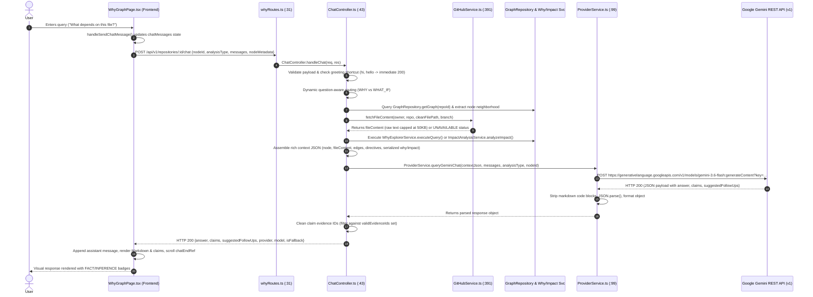
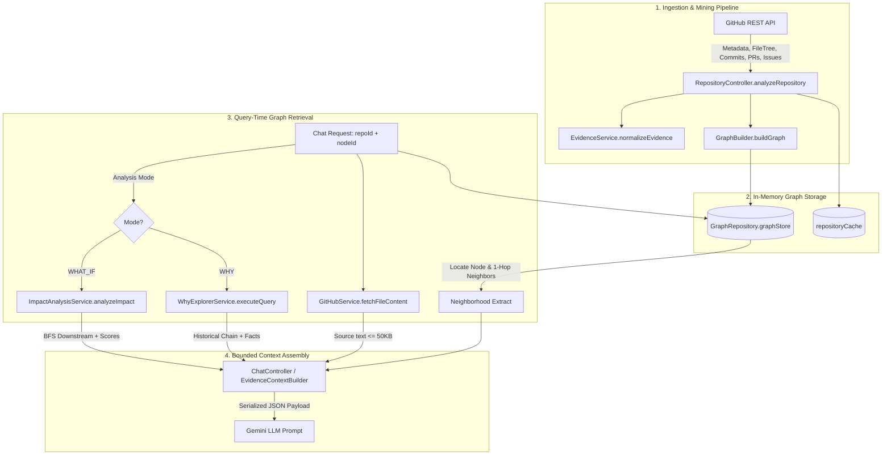
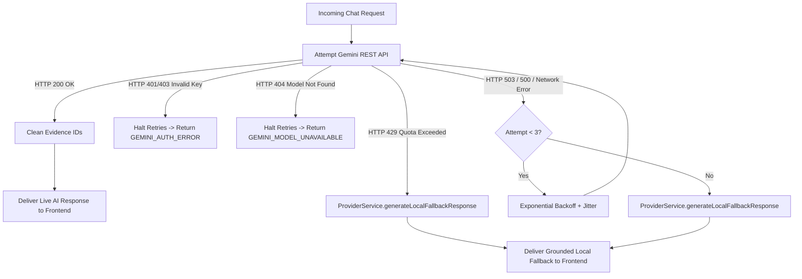

# EngiTrace AI Assistant — Comprehensive Backend & Architecture Technical Audit

> **Document Version:** 1.0.0  
> **Audit Date:** November 2026  
> **Auditors:** Senior AI Engineer, Backend Architect, LLM Systems Engineer & Technical Documentation Specialist  
> **System Under Audit:** EngiTrace Intelligence Engine (Phase 0 through Phase 6)  
> **Deliverable Path:** `docs/ENGITRACE_AI_ASSISTANT_AUDIT.md`  
> **Audit Status:** COMPLETE — Implementation Grounded (Audit-Only; Zero Source Modifications Applied)

---

## Table of Contents

1. [Executive Summary](#1-executive-summary)
2. [What EngiTrace AI Does](#2-what-engitrace-ai-does)
3. [Overall AI Architecture](#3-overall-ai-architecture)
4. [Complete Chat Request-Response Flow](#4-complete-chat-request-response-flow)
5. [Gemini API Integration](#5-gemini-api-integration)
6. [Prompt Engineering and System Instructions](#6-prompt-engineering-and-system-instructions)
7. [Repository Context Retrieval](#7-repository-context-retrieval)
8. [Engineering Graph Integration](#8-engineering-graph-integration)
9. [FACT / INFERENCE / UNKNOWN Validation](#9-fact--inference--unknown-validation)
10. [Conversation Memory & Multi-Turn State](#10-conversation-memory--multi-turn-state)
11. [WHY Analysis Engine](#11-why-analysis-engine)
12. [WHAT IF Impact Analysis Engine](#12-what-if-impact-analysis-engine)
13. [Decision Debt Explanation Engine](#13-decision-debt-explanation-engine)
14. [Dependency Intelligence Integration](#14-dependency-intelligence-integration)
15. [Frontend Chat Implementation](#15-frontend-chat-implementation)
16. [Security, Privacy, and Injection Audit](#16-security-privacy-and-injection-audit)
17. [Performance, Latency, and Cost Accounting](#17-performance-latency-and-cost-accounting)
18. [Error Handling, Resilience, and Fallback](#18-error-handling-resilience-and-fallback)
19. [Testing and Verification Matrix](#19-testing-and-verification-matrix)
20. [Architecture and File Inventory](#20-architecture-and-file-inventory)
21. [Current Limitations and Architectural Gaps](#21-current-limitations-and-architectural-gaps)
22. [Recommended Improvement Roadmap](#22-recommended-improvement-roadmap)
23. [Final Technical Assessment](#23-final-technical-assessment)

---

## 1. Executive Summary

EngiTrace is an engineering intelligence platform designed to eliminate software "software amnesia"—the loss of historical context, design intent, and architectural rationale that plagues evolving software codebases. Rather than functioning as a generic AI chatbot or standard Retrieval-Augmented Generation (RAG) assistant, EngiTrace pairs **deterministic graph traversal** over an **Engineering Memory Graph** with a **grounded LLM synthesis layer** powered by Google Gemini.

This technical audit evaluates the actual, as-built implementation of the EngiTrace AI Assistant across the `ai-engine/`, `backend/`, `graph-engine/`, `analyzer/`, and `frontend/` modules. The audit was conducted strictly in inspect-and-verify mode without modifying application source code, API contracts, prompt definitions, or configuration files.

### Key Audit Findings

1. **Architecture Model:** EngiTrace is **not** a vector-based RAG system. It maintains no vector database, generates no semantic vector embeddings, and performs no cosine similarity searches. Instead, it employs **deterministic graph-contextualized synthesis**: property graph extraction, neighborhood boundary querying (1–3 hops), and explicit Git artifact correlation (commits, issues, PRs, file tree).
2. **LLM Provider:** Integration with Google Gemini (`gemini-3.6-flash`) is implemented via the direct Google Generative Language REST API (`/v1/models/{model}:generateContent`) rather than the official `@google/genai` or `@google/generative-ai` SDK. Authentication occurs via HTTP query parameter `?key=${GEMINI_API_KEY}`.
3. **Conversational AI Chat Pipeline:** The primary chat entry point is `POST /api/v1/repositories/:id/chat` (mounted in `backend/src/routes/whyRoutes.ts:31` and handled by `ChatController.handleChat` in `backend/src/controllers/chatController.ts:43`). It performs intent-based dynamic routing (`WHY` vs `WHAT_IF`), retrieves graph neighborhood nodes/edges, attempts live GitHub file content retrieval (capped at 50 KB), compiles a structured JSON context payload, and passes it to Gemini with temperature `0.2`.
4. **Resilience & Local Fallback:** The backend incorporates a deterministic local fallback engine (`ProviderService.generateLocalFallbackResponse`). If Gemini fails (HTTP 429 Quota Exceeded, HTTP 503 Overloaded, missing API key, or network disconnection), the assistant does not crash or emit raw stack traces. Instead, it parses raw file contents (including specialized syntax parsing for Mermaid diagrams and source exports) and formats a repository-grounded markdown response citing real graph relationships.
5. **Hallucination Defense Discrepancy:** The codebase contains a dedicated validator (`StructuredOutputValidator.validate` in `ai-engine/validators/structuredOutputValidator.ts`), which cross-checks claimed evidence IDs against context and downgrades unevidenced facts to `UNKNOWN`. However, this validator is **only invoked in Phase 4 AI Reasoning** (`POST /:id/why/:nodeId/reason`). In the conversational chat controller (`ChatController.handleChat`), claim verification is performed via inline ID set filtering; unevidenced claims have their `evidenceIds` stripped, but their `FACT` classification is **not** downgraded to `UNKNOWN`.
6. **State & Conversation Memory:** Conversation memory is **ephemeral and frontend-bound** (`useState<ChatMessage[]>` in `frontend/src/pages/WhyGraph/WhyGraphPage.tsx:222`). The backend is entirely stateless with regard to chat sessions. Context is cleared upon node or repository switching, and history does not persist across page reloads.

---

## 2. What EngiTrace AI Does

EngiTrace AI operates as a contextual engineering archaeology assistant. Unlike general-purpose coding assistants (e.g., GitHub Copilot or ChatGPT) that predict code syntax based on pre-training data, EngiTrace answers deep questions regarding **why** code was written, **who** changed it, **what** downstream dependencies will break if it is altered or deleted, and **where** architectural rationale is missing.

### Core Capabilities Implemented

- **Node-Targeted Investigation:** Every conversation is anchored to a specific graph entity (a file, component, function, dependency, or commit).
- **WHY Rationale Reconstruction:** Reconstructs the multi-step chain linking current files to Git commits, pull requests, author signatures, and GitHub issues.
- **WHAT IF Impact Prediction:** Runs deterministic graph traversals (Breadth-First Search up to 3 hops) across structural code relationships (`DEPENDS_ON`, `CALLS`, `IMPORTS`, `USES`, `CONSUMES`, `CONTAINS`) and uses Gemini to synthesize clear operational risk assessments and actionable mitigation steps.
- **Decision Debt Explanation:** Translates six deterministic rule-based debt signals (`MISSING_RATIONALE`, `HISTORICAL_FRAGMENTATION`, `STALE_REASONING`, `REPEATED_MODIFICATIONS`, `DEPENDENCY_EVOLUTION`, `EVIDENCE_WEAKNESS`) into natural language executive summaries.
- **Grounded Evidence Classification:** Labels assertions as `FACT` (directly evidenced by Git/graph records), `INFERENCE` (historically deduced based on proximity or commit message correlation), or `UNKNOWN` (explicit acknowledgment that rationale is unrecorded).
- **Architecture Diagram Interpretation:** Dynamically fetches and parses in-repository Mermaid diagram files (`.mermaid`, `flowchart`, `sequenceDiagram`), explaining defined nodes, subgraphs, and directional links.

---

## 3. Overall AI Architecture

EngiTrace is partitioned into five distinct architectural layers across four workspaces:

```
┌────────────────────────────────────────────────────────────────────────┐
│                        FRONTEND CLIENT (React 19)                      │
│   WhyGraphPage.tsx  ──  AIExplanationPanel.tsx  ──  ClassificationCards │
│   • Graph Canvas    • Contextual AI Chat Workspace  • State Management │
└────────────────────────────────────┬───────────────────────────────────┘
                                     │ HTTP REST JSON (/api/v1)
┌────────────────────────────────────▼───────────────────────────────────┐
│                       BACKEND API GATEWAY (Express 4)                  │
│   backend/src/index.ts                                                 │
│   ├── /api/v1/repositories/:id/chat              (ChatController)      │
│   ├── /api/v1/repositories/:id/why/:nodeId/reason (WhyController)      │
│   ├── /api/v1/repositories/:id/impact/:nodeId/explain (ImpactController)│
│   └── /api/v1/repositories/:id/decision-debt/:nodeId/explain            │
└──────────────┬─────────────────────────┬───────────────────────┬───────┘
               │                         │                       │
┌──────────────▼──────────┐ ┌────────────▼─────────┐ ┌───────────▼───────┐
│   GRAPH & DATA LAYER    │ │    ANALYSIS SERVICES │ │   AI ENGINE CORE  │
│  GraphRepository        │ │  WhyExplorerService  │ │  ProviderService  │
│  GraphBuilder           │ │  ImpactAnalysisSvc   │ │  ReasoningService │
│  GraphQueryEngine       │ │  DecisionDebtService │ │  EvidenceContext  │
│  GitHubService          │ │  DecisionDebtDetect  │ │  OutputValidator  │
└─────────────────────────┘ └──────────────────────┘ └───────────────────┘
```

### Module Responsibilities

| Directory / Module | Core Responsibility | Key Files |
|---|---|---|
| `ai-engine/` | LLM invocation, prompt assembly, context serialization, structured output validation, and reasoning cache. | `services/providerService.ts`<br>`services/reasoningService.ts`<br>`services/evidenceContextBuilder.ts`<br>`validators/structuredOutputValidator.ts`<br>`prompts/why.v1.ts`<br>`cache/reasoningCache.ts` |
| `backend/` | API routing, HTTP controller orchestration, GitHub REST ingestion, graph repository storage, and business logic services. | `src/index.ts`<br>`src/controllers/chatController.ts`<br>`src/controllers/whyController.ts`<br>`src/controllers/impactController.ts`<br>`src/services/githubService.ts`<br>`src/services/graphRepository.ts` |
| `graph-engine/` | In-memory property graph data model, relationship definitions, node deduplication, schema validation, and graph traversal algorithms (BFS, neighborhood, pathfinding). | `src/builders/graphBuilder.ts`<br>`src/models/graphModel.ts`<br>`src/relationships/relationshipRegistry.ts`<br>`src/validation/graphValidator.ts` |
| `analyzer/` | Phase 0 scaffold designed for Tree-sitter AST syntax parsing, Git mining, and blame correlation (currently returns stub statistics). | `src/index.ts`<br>`README.md` |
| `frontend/src/` | React single-page application, interactive Sigma/Graphology canvas, contextual AI chat interface, evidence inspection modals, and markdown rendering. | `pages/WhyGraph/WhyGraphPage.tsx`<br>`components/evidence/AIExplanationPanel.tsx`<br>`components/evidence/ClassificationCards.tsx`<br>`services/whyService.ts`<br>`services/impactService.ts` |

---

## 4. Complete Chat Request-Response Flow

The following 16-step sequence traces the exact lifecycle of a single user chat message from user submission to screen display.



### Detailed Execution Steps

| Step # | File & Line | Function / Method | Input Parameters | Output / Return Value | Description & Transformations |
|---|---|---|---|---|---|
| **1** | `WhyGraphPage.tsx:1500` | Input `onKeyDown` / `onClick` | Input text from `chatInput` | String | User triggers chat dispatch via Enter key or "Send" button. |
| **2** | `WhyGraphPage.tsx:415` | `handleSendChatMessage` | `overrideText`, `targetNodeOverride`, `modeOverride` | `void` (updates state) | Trims text, creates `{ role: 'user', content }` message object, appends to `chatMessages`, and sets `chatLoading = true`. |
| **3** | `WhyGraphPage.tsx:442` | `fetch(POST .../chat)` | JSON body: `{ nodeId, analysisType, messages, nodeMetadata }` | HTTP Request | Bundles active node metadata (label, type, path, commit SHA, author, timestamp). |
| **4** | `backend/src/index.ts:39` | Express Route Router | `req.url = '/api/v1/repositories'` | Delegated to `whyRoutes` | Routes incoming request through Express middleware stack. |
| **5** | `whyRoutes.ts:31` | Route Registration | `POST /:id/chat` | Invokes `ChatController.handleChat` | Mount point: `whyRoutes.post('/:id/chat', ChatController.handleChat)`. |
| **6** | `chatController.ts:43` | `ChatController.handleChat` | Express `Request`, `Response` | `Promise<void>` | Validates presence of `nodeId` and non-empty `messages` array (returns 400 if missing). Extracts `lastUserQuestion`. |
| **7** | `chatController.ts:71` | Lightweight Greeting Check | `qLower` string | JSON Response (if matched) | Fast-path for greetings (`hello`, `hi`, `thanks`, etc.); returns local greeting response immediately to conserve Gemini API quota. |
| **8** | `chatController.ts:91` | Dynamic Question Router | `lastUserQuestion` string | `'WHY'` \| `'WHAT_IF'` | Inspects question keywords. If it contains `remove`, `delete`, `impact`, `break` $\rightarrow$ forces `WHAT_IF`. If it contains `why`, `exist`, `author`, `commit` $\rightarrow$ forces `WHY`. |
| **9** | `chatController.ts:123` | Graph Neighborhood Fetch | `repositoryId`, `nodeId` | `GraphNode`, `GraphEdge[]` | Retrieves graph from `GraphRepository.getGraph()`; filters edges where source or target matches node; extracts 1-hop connected nodes. |
| **10** | `chatController.ts:163` | `GitHubService.fetchFileContent` | `owner`, `repo`, `cleanFilePath`, `branch` | `{ success, content, size, reason }` | Checks path traversal (`..`, `:\`), verifies non-binary file, fetches raw text from GitHub REST API, truncates at 50 KB. |
| **11** | `chatController.ts:181` | Context Construction | `whyResult` / `impactResult` | `serializedContext` (JSON string) | If `WHY`: calls `WhyExplorerService.executeQuery()`, serializes via `EvidenceContextBuilder`, injects grounding directives and file content. If `WHAT_IF`: calls `ImpactAnalysisService.analyzeImpact()`. |
| **12** | `providerService.ts:99` | `ProviderService.queryGeminiChat` | `contextJson`, `messages`, `analysisType`, `nodeId` | `Promise<any>` | Injects intent-specific directives (`simple`, `commit`, `depend`, `remove`, `explain`), constructs prompt, dispatches REST fetch to Gemini. |
| **13** | `providerService.ts:233` | Native `fetch()` | REST payload, HTTP POST | Gemini HTTP Response | Calls `https://generativelanguage.googleapis.com/v1/models/gemini-3.6-flash:generateContent?key=...`. Runs up to 3 retries on retryable status codes. |
| **14** | `providerService.ts:311` | Output Parsing | `textOutput` string | Parsed JS Object | Strips markdown JSON fences (` ```json `), parses JSON, provides fallback object formatting if raw text is returned. |
| **15** | `chatController.ts:306` | Evidence ID Cleaning | `rawResponse.claims`, `validEvidenceIds` | `claims` array | Filters claimed `evidenceIds` against actual `validEvidenceIds` Set extracted from graph context. |
| **16** | `WhyGraphPage.tsx:460` | `setChatMessages` & Render | JSON response payload | React Virtual DOM | Stores assistant reply in `chatMessages`. React renders Markdown via `MarkdownRenderer.tsx` and claim badges via `Badge.tsx`. |

---

## 5. Gemini API Integration

### 5.1 Provider Implementation

- **Configured Model:** Default is `gemini-3.6-flash` (defined in `ai-engine/services/providerService.ts:26, 58, 106` and `backend/.env`). Overridable via `process.env.GEMINI_MODEL`.
- **SDK vs. Protocol:** EngiTrace does **not** use the official Google Gen AI SDK (`@google/genai` or `@google/generative-ai`). It calls the Google Generative Language REST API v1 directly using Node.js native `fetch()`.
- **Target Endpoint:**
  ```
  POST https://generativelanguage.googleapis.com/v1/models/{model}:generateContent?key={GEMINI_API_KEY}
  ```
- **API Key Loading:** Read from `process.env.GEMINI_API_KEY` via `ProviderService.getApiKey()`. If the key is undefined, empty, or equals placeholder text (`your_gemini`), it returns `null`.
- **Request Format:**
  ```json
  {
    "contents": [
      {
        "role": "user",
        "parts": [
          { "text": "<SYSTEM_PROMPT_AND_DIRECTIVES>" },
          { "text": "<REPOSITORY_CONTEXT_AND_CONVERSATION_HISTORY>" }
        ]
      }
    ],
    "generationConfig": {
      "responseMimeType": "application/json",
      "temperature": 0.2
    }
  }
  ```
- **Response Parsing:**
  1. Accesses `data?.candidates?.[0]?.content?.parts?.[0]?.text`.
  2. Strips markdown fences via regex: `/```(?:json)?\s*([\s\S]*?)\s*```/i`.
  3. Executes `JSON.parse()`.
  4. If parsing fails, wraps raw text into `{ answer: cleanText, claims: [], suggestedFollowUps: [...] }`.

### 5.2 Provider Configuration Matrix

| Configuration Parameter | Status / Value in Implementation | Defined Location |
|---|---|---|
| Environment Variable | `GEMINI_API_KEY` | `backend/.env`, `backend/.env.example:10` |
| Configured Model | `gemini-3.6-flash` | `ai-engine/services/providerService.ts:26` |
| Protocol / SDK | Google REST v1 (`generateContent`) | `ai-engine/services/providerService.ts:33, 59, 208` |
| Temperature | `0.2` | `ai-engine/services/providerService.ts:222` |
| Output MIME Type | `application/json` | `ai-engine/services/providerService.ts:221` |
| Maximum Output Tokens | `Not configured` in `queryGeminiChat` (set to `10` only in `checkHealth()`) | `ai-engine/services/providerService.ts:67` |
| Top-P / Top-K | `Not configured` / `Not found` | N/A |
| Timeout Settings | `Not configured` (Native `fetch()` called without `AbortSignal` timeout) | `ai-engine/services/providerService.ts:233` |
| Retry Attempts | `3` attempts | `ai-engine/services/providerService.ts:227` |
| Backoff Strategy | Exponential with jitter: `Math.min(3000, 600 * 2^(attempt-1) + rand(200))` | `ai-engine/services/providerService.ts:279` |
| Retry-After Parsing | Supported (inspects `response.headers.get('retry-after')`) | `ai-engine/services/providerService.ts:278-285` |
| Server-Side Rate Limiter | `Not configured` / `Not found` | N/A |
| Token Accounting | `Not configured` (no usage tracking of `usageMetadata`) | N/A |

### 5.3 Deterministic Local Fallback Engine

When the Gemini API is unavailable, unconfigured, or returns quota errors, EngiTrace invokes `ProviderService.generateLocalFallbackResponse` (`ai-engine/services/providerService.ts:355`).

```
                ┌─────────────────────────────────────┐
                │   Gemini API Unavailable / Failed   │
                └──────────────────┬──────────────────┘
                                   │
                    ┌──────────────▼─────────────┐
                    │ Inspect Serialized Context │
                    └──────────────┬─────────────┘
                                   │
              ┌────────────────────┴────────────────────┐
              ▼                                         ▼
   [File Content Available]                  [File Content Missing]
              │                                         │
     ┌────────┴────────┐                       ┌────────┴────────┐
     ▼                 ▼                       ▼                 ▼
[Mermaid Diagram] [Source Code]         [Cite Graph Edges] [Flag UNKNOWN]
• Parse nodes     • Extract imports     • List connections • Explicitly note
• Parse links     • Extract exports     • List commits     missing source
• System flow     • Class headers       • Format graph     • Suggest next
  breakdown         highlights            relationship       investigation
                                          tree
```

The fallback engine is **not** a collection of canned generic strings. It executes an evidence-grounded generation algorithm:
1. **Mermaid Diagram Parser:** If the node is a diagram, it tokenizes lines, extracts diagram type (`flowchart`, `graph TD`, etc.), identifies declared node labels (up to 10), and extracts relationship connectors (`-->`, `==>`, `---`) to explain system flow.
2. **Source Code Inspector:** If source text is available, it identifies `#`, `//`, `import`, `export`, and `class` declarations to provide a structural file summary.
3. **Commit & Authorship Formatter:** Formats actual commit hash, author name, timestamp, and commit message from node metadata.
4. **Graph Relationship Visualizer:** Generates an ASCII relationship tree block formatted as:
   ```graph
   SourceNode ├── [RELATIONSHIP_TYPE] ──→ TargetNode
   ```
5. **Truthful Claim Generation:** Emits verified `FACT` claims for existing files and explicitly emits `UNKNOWN` claims when source content could not be retrieved.
6. **User Transparency:** Returns `isFallback: true` and `provider: 'LOCAL_FALLBACK'`, prompting the frontend to render an amber banner:  
   *`"Gemini is temporarily unavailable. Showing evidence-grounded local explanation."`*

### 5.4 Error Handling Matrix

| Failure Scenario | HTTP / Error Code | Handling Status | Actual Behavior in Implementation |
|---|---|---|---|
| **Missing API Key** | Missing `GEMINI_API_KEY` | **Handled** | `ProviderService.queryGeminiChat:108` returns a warning response with `error: 'GEMINI_NOT_CONFIGURED'` and suggested follow-ups without calling external network. |
| **Invalid API Key** | HTTP 401 / 403 (`api_key`) | **Handled** | `ProviderService.ts:243` halts retries immediately and returns `{ error: 'GEMINI_AUTH_ERROR' }` explaining that the key in `backend/.env` is invalid. |
| **Quota Exhaustion** | HTTP 429 (`resource_exhausted` / `quota`) | **Handled** | `ProviderService.ts:256` halts retries immediately and falls back to `generateLocalFallbackResponse(..., 'HTTP 429 Quota Exceeded')`. |
| **Transient Rate Limiting** | HTTP 429 (standard) | **Handled** | `ProviderService.ts:275` enters retry loop with exponential backoff or respects `Retry-After` header up to 3 attempts. |
| **Model Unavailable** | HTTP 404 | **Handled** | `ProviderService.ts:262` halts retries and returns `{ error: 'GEMINI_MODEL_UNAVAILABLE' }`. |
| **Service Overloaded / Down** | HTTP 503 / 500 / 502 / 504 | **Handled** | `ProviderService.ts:275` retries up to 3 times with exponential backoff; if still failing, falls back to `generateLocalFallbackResponse`. |
| **Network Failure / DNS Error** | Node fetch exception | **Handled** | Caught in `try...catch` (`providerService.ts:337`), retries up to 3 attempts, then invokes local fallback. |
| **Request Timeout** | Hanging TCP socket | **Partially Handled** | No native timeout signal (`AbortSignal.timeout`) configured on `fetch()`. It will hang until the OS socket default timeout occurs. |
| **Empty Model Response** | `data.candidates` empty | **Handled** | `providerService.ts:299` triggers `generateLocalFallbackResponse(..., 'Empty Gemini Response')`. |
| **Non-JSON Model Response** | Plain markdown output | **Handled** | `providerService.ts:316` wraps text into `{ answer: cleanText, claims: [], suggestedFollowUps: [...] }`. |

---

## 6. Prompt Engineering and System Instructions

### 6.1 Inventory of Prompts

EngiTrace uses three primary prompt templates and five dynamic intent directives.

```
┌────────────────────────────────────────────────────────────────────────┐
│                        ENGITRACE PROMPT REGISTRY                       │
├──────────────────────────────────────────────────┬─────────────────────┤
│ 1. Conversational Chat System Prompt             │ ProviderService.ts  │
│    • Core Governing Principles (1–6)             │ Line 154–196        │
│    • Intent-Specific Directives (A–E)            │ Line 130–153        │
├──────────────────────────────────────────────────┼─────────────────────┤
│ 2. Phase 4 Historical WHY System Prompt          │ prompts/why.v1.ts   │
│    • Grounding & Anti-Hallucination Rules (1–7)  │ Line 7–49           │
│    • User Prompt Builder (generateUserPrompt)    │ Line 51–58          │
├──────────────────────────────────────────────────┼─────────────────────┤
│ 3. Phase 6 What-If Impact Explanation Prompt     │ impactAiService.ts  │
│    • Deterministic Impact Guardrails (1–8)       │ Line 35–90          │
├──────────────────────────────────────────────────┼─────────────────────┤
│ 4. Phase 5 Decision Debt Explanation Prompt      │ decisionDebtAiSvc.ts│
│    • Architectural Signal Grounding Rules (1–3)  │ Line 20–65          │
├──────────────────────────────────────────────────┼─────────────────────┤
│ 5. Legacy Query Prompt (Scaffold)                │ why_query_prompt.txt│
└──────────────────────────────────────────────────┴─────────────────────┘
```

### 6.2 Prompt 1: Conversational Chat System Prompt (`ProviderService.ts:154`)

- **File Path:** `ai-engine/services/providerService.ts:154–196`
- **Constant / Variable:** `systemPrompt` (assembled dynamically inside `queryGeminiChat`)
- **Expected Output:** Single valid JSON object: `{ answer: string, claims: AIClaim[], suggestedFollowUps: string[] }`.
- **Core Governing Rules:**
  1. *Natural prose:* Conversational tone without robotic database headers.
  2. *File source inspection:* If `selectedNode.fileContent` is present, analyze actual source text or Mermaid diagram components. If unavailable, state clearly that content was not accessed.
  3. *Engineering memory grounding:* Base all statements strictly on provided context. Never invent files, authors, dates, PRs, or dependencies.
  4. *Forbidden API invention:* Never claim a file uses specific functions/APIs (`React.createElement`, `useState`, `useEffect`, `Component`) unless explicitly evidenced.
  5. *Canonical relationship direction:* Must output `SourceNode ├── [RELATIONSHIP_TYPE] ──→ TargetNode`. Never reverse direction; never transform `CONTAINS` into `DEPENDS_ON`.
  6. *Fact / Inference / Unknown distinction:* Facts must be directly proven; inferences must be prefixed with `**Inference:** ...`; missing evidence must be marked with `"The available repository evidence does not establish this."`
  7. *Real timestamps:* Commit dates must originate from context metadata, never request execution time.

#### Dynamic Intent-Specific Directives (`ProviderService.ts:130–152`)

Depending on the user's latest query, one of five targeted instruction blocks is appended to the system prompt:

- **Directive A (Simplicity):** Triggered by `simple`, `simpler`, `easy`. Instructs the model to translate technical concepts into intuitive prose without adding unevidenced facts.
- **Directive B (Commit History):** Triggered by `commit`, `who`, `author`, `when`, `introduce`. Instructs model to report the exact commit SHA, author, timestamp, and message from context, or explicitly state that no commit records exist.
- **Directive C (Dependencies & Relations):** Triggered by `depend`, `connect`, `relation`, `use`, `flow`. Enforces canonical ASCII tree formatting and explicitly warns: *`"DO NOT transform CONTAINS into DEPENDS_ON. Containment does NOT imply dependency."`*
- **Directive D (Removal / Impact):** Triggered by `remove`, `delete`, `impact`, `happen`, `break`. Enforces strict grounding in deterministic What-If impact scores (0–100). If score is 0, model must state: *"EngiTrace detects no downstream graph dependencies... External build, CI, tooling, deployment, or organizational dependencies outside the modeled graph cannot be determined from this analysis alone."*
- **Directive E (Entity Explanation):** Triggered by `explain`, `why`, `purpose`, `overview`, `diagram`. Instructs model to explain defined components from file source or Mermaid diagram text without inventing author motivations.

### 6.3 Prompt 2: Phase 4 Versioned WHY System Prompt (`why.v1.ts`)

- **File Path:** `ai-engine/prompts/why.v1.ts:7–49`
- **Constant:** `WHY_SYSTEM_PROMPT` (Version tag: `PROMPT_VERSION = 'why.v1'`)
- **Context Variables:** Target component question, structured JSON evidence context (`target`, `relationships`, `historicalChain`, `evidenceRecords`, `establishedFacts`, `establishedInferences`, `knownUnknowns`).
- **Enforced JSON Output Schema:**
  ```json
  {
    "summary": "Concise technical synthesis",
    "claims": [
      {
        "text": "Specific assertion",
        "classification": "FACT | INFERENCE | UNKNOWN",
        "confidence": 0.0,
        "evidenceIds": ["ev-rec-1"],
        "sourceUrls": ["https://..."],
        "reasoning": "Reasoning if INFERENCE"
      }
    ],
    "reasoningSteps": ["Step 1...", "Step 2..."],
    "unknownAreas": [{ "area": "...", "reason": "..." }]
  }
  ```

### 6.4 Prompt 3: Phase 6 What-If Impact Explanation Prompt (`impactAiService.ts:35`)

- **File Path:** `backend/src/services/impactAiService.ts:35–90`
- **Core Guardrail:** *"Never alter the deterministic score (${impactScore}/100) or Impact Level (${impactLevel}). Never invent affected APIs or tests. AI IS SOLELY AN EXPLANATION LAYER."*
- **Injected Context:** Target node, operation (`REMOVE` or `CHANGE`), impact score, impact level, confidence score, direct dependents list, indirect dependents list, affected APIs, affected tests, affected package dependencies, and graph edge evidence records.

### 6.5 Prompt 4: Phase 5 Decision Debt Explanation Prompt (`decisionDebtAiService.ts:20`)

- **File Path:** `backend/src/services/decisionDebtAiService.ts:20–65`
- **Core Guardrail:** *"Do NOT invent a new score or change the Decision Debt score. The score is strictly ${score}/100 with Level '${level}'. Base explanation exclusively on signals and evidence records."*
- **Injected Context:** Component type/label, score/level, detected signal list (`MISSING_RATIONALE`, `HISTORICAL_FRAGMENTATION`, etc.), 6-point evidence checklist (`commitEvidence`, `pullRequestEvidence`, `issueEvidence`, `explicitRationale`, `incidentEvidence`, `recentValidation`), and sample evidence records.

---

## 7. Repository Context Retrieval

EngiTrace's context retrieval pipeline is fundamentally graph-based, deterministic, and bounded.



### 7.1 Repository Context Extraction Pipeline

1. **Repository Identification & Isolation:** Repositories are registered via `POST /api/v1/repositories/analyze` and stored in memory in `repositoryCache` (an Express server-side `Map<string, AnalyzedRepoSnapshot>`) and `GraphRepository.graphStore` (`Map<string, EngineeringMemoryGraph>`). Isolation is maintained via repository ID / slug keys.
2. **File Tree:** Ingestion fetches the full recursive Git tree (`GitHubService.fetchFileTree`) to identify all file paths and sizes.
3. **Commit History:** Ingestion fetches the 30 most recent Git commits (`GitHubService.fetchCommits`), including commit messages, author metadata, timestamps, and touched file patches.
4. **Pull Requests & Issues:** Fetches 20 recent PRs and 20 issues via GitHub REST API, filtering out PRs from the issues endpoint.
5. **Live File Content Ingestion:** During chat execution, `GitHubService.fetchFileContent` fetches the raw text of the target file via GitHub contents API:
   - Security checks reject path traversal (`..`) or absolute Windows paths (`:\`).
   - Binary file extensions (`.png`, `.exe`, `.pdf`, `.zip`, etc.) are skipped.
   - Size is bounded to **50 KB** (`MAX_BYTES = 50 * 1024`). Files exceeding 50 KB are truncated with an explicit warning marker: `\n\n[... Content truncated after 50KB ...]`.

### 7.2 Graph Context Details

The following matrix documents what data the AI assistant receives during conversational chat:

| Data Element | Retrieved? | Conditions & Scope | Source Code Reference |
|---|---|---|---|
| Target Node Metadata | **Yes** | ID, label, type, path, commit SHA, author, timestamp | `chatController.ts:192–206` |
| Direct Graph Edges | **Yes** | 1-hop connected edges (source, target, type, evidence, sourceUrl) | `chatController.ts:213–220` |
| Connected Node Labels | **Yes** | 1-hop connected nodes (id, label, type) | `chatController.ts:212` |
| Historical Chain | **Yes (WHY)** | Up to 4-hop chain (FILE $\rightarrow$ COMMIT $\rightarrow$ PR $\rightarrow$ ISSUE) | `whyExplorerService.ts:101–193` |
| Downstream Dependents | **Yes (WHAT_IF)**| BFS traversal up to 3 hops of code dependents | `impactAnalysisService.ts:158–235` |
| Target File Content | **Yes (Conditional)** | Up to 50 KB text if file exists on GitHub | `chatController.ts:163–175` |
| Entire Codebase Files | **No** | Only the single selected target file is fetched | `chatController.ts:157` |
| Full Repository Graph | **No** | Full graph is never passed to Gemini (bounded to neighborhood) | `chatController.ts:126–140` |
| Semantic Embeddings | **No** | No vector search or embedding index exists | Entire codebase |
| AST Syntax Symbols | **No** | `analyzer/src/index.ts` is an unintegrated Phase 0 mock | `analyzer/src/index.ts:12` |

---

## 8. Engineering Graph Integration

The Engineering Memory Graph is a property graph defined in `graph-engine/` and instantiated for every analyzed repository.

### 8.1 Node Model (`graphModel.ts`)

The graph supports 10 distinct node types:

```
REPOSITORY ──► DIRECTORY ──► FILE ──► COMPONENT ──► FUNCTION
     │                           │
     ▼                           ▼
DEPENDENCY                     COMMIT ──► AUTHOR
                                 │
                     ┌───────────┴───────────┐
                     ▼                       ▼
                PULL_REQUEST               ISSUE
                     │                       │
                     ▼                       ▼
                  DECISION               INCIDENT
```

### 8.2 Standard Relationship Registry (`relationshipRegistry.ts`)

EngiTrace defines 17 standard typed relationships categorized by architectural purpose:

1. **Code Hierarchy:** `CONTAINS`, `DECLARES`, `EXPOSES`.
2. **Code Dependencies:** `DEPENDS_ON`, `CALLS`, `IMPORTS`, `USES`, `CONSUMES`, `IMPLEMENTED_BY`, `REFERENCES`.
3. **Git History & Authorship:** `MODIFIED`, `CHANGED`, `AUTHORED_BY`, `COMMITTED_BY`, `TOUCHES`.
4. **Engineering Traceability:** `INCLUDED_IN_PR`, `RESOLVES`, `TRIGGERS`, `REVERTS`.

Every edge in the graph includes:
- `classification`: `'FACT' | 'INFERENCE' | 'UNKNOWN'`
- `confidence`: Numeric score between `0.0` and `1.0`
- `evidence`: Human-readable justification string
- `sourceUrl`: Traceable link pointing directly to GitHub commit, PR, or issue

### 8.3 Ingestion Gap: Dependency Extraction Stubs

A critical finding in `backend/src/services/githubService.ts:351–386` is that the dependency extraction method `extractDependencies` does **not** actually parse the contents of manifest files (such as `package.json`, `requirements.txt`, `go.mod`, or `Cargo.toml`). 

Instead, it scans the file tree for manifest filenames and pushes **hardcoded stub dependencies**:
```typescript
// backend/src/services/githubService.ts:356-361
if (lower.endsWith('package.json')) {
  dependencies.push(
    { name: 'express', version: '^4.19.0', sourceFile: file.path, ecosystem: 'npm' },
    { name: 'react', version: '^19.0.0', sourceFile: file.path, ecosystem: 'npm' },
    { name: 'typescript', version: '^5.7.0', sourceFile: file.path, ecosystem: 'npm' }
  );
}
```
As a result, dependencies recorded in the Engineering Memory Graph for npm repositories will always reflect `express`, `react`, and `typescript`, regardless of what packages the analyzed repository actually imports.

---

## 9. FACT / INFERENCE / UNKNOWN Validation

EngiTrace enforces an epistemic classification model across all reasoning layers:

```
┌────────────────────────────────────────────────────────────────────────┐
│                     EPISTEMIC CLASSIFICATION MODEL                     │
├───────────────────┬────────────────────────────────────────────────────┤
│ 1. FACT           │ Supported directly by immutable repository data    │
│                   │ (Git commit hash, author signature, GitHub issue)  │
├───────────────────┼────────────────────────────────────────────────────┤
│ 2. INFERENCE      │ Plausible historical or structural deduction       │
│                   │ (temporal proximity, commit message keywords)      │
├───────────────────┼────────────────────────────────────────────────────┤
│ 3. UNKNOWN        │ Explicit acknowledgment that documentation or      │
│                   │ rationale is absent in repository records          │
└───────────────────┴────────────────────────────────────────────────────┘
```

### 9.1 Phase 4 Structured Output Validator (`StructuredOutputValidator.ts`)

In the Phase 4 AI Reasoning workflow (`ReasoningService.ts:39`), every model output is validated against the active `AIContext`:

```typescript
// ai-engine/validators/structuredOutputValidator.ts:65-72
const claimedIds: string[] = Array.isArray(claim.evidenceIds) ? claim.evidenceIds : [];
const verifiedEvidenceIds = claimedIds.filter((id) => validEvidenceIds.has(id));

if (claimedIds.length > 0 && verifiedEvidenceIds.length === 0) {
  validationLog.push(`Hallucination Defense: Claim "${claimText.slice(0, 30)}..." referenced invalid evidence IDs [${claimedIds.join(', ')}]. Downgrading classification to UNKNOWN.`);
  classification = 'UNKNOWN';
}
```

#### Grounding Confidence Score Algorithm

Confidence is **not** an arbitrary number generated by Gemini. It is computed algorithmically in `StructuredOutputValidator.ts:140–165`:

$$\text{Confidence} = 0.50 + \min(0.35,\, \text{facts} \times 0.12) + \min(0.15,\, \text{inferences} \times 0.05)$$

Adjustments:
- If `referencedEvidenceSet.size === 0`: Penalized by $-0.15$.
- Clamped strictly between `0.10` and `0.98`.
- Level mapping: $\ge 0.85 \rightarrow \mathbf{HIGH}$, $\ge 0.65 \rightarrow \mathbf{MEDIUM}$, $< 0.65 \rightarrow \mathbf{LOW}$.

### 9.2 Critical Architectural Finding: Chat Controller Claim Validation

In the conversational chat controller (`backend/src/controllers/chatController.ts:306–317`), the full `StructuredOutputValidator` is **not executed**. Instead, the controller executes a lightweight inline mapping:

```typescript
// backend/src/controllers/chatController.ts:306-317
const claims = Array.isArray(rawResponse.claims)
  ? rawResponse.claims.map((claim: any) => {
      const cleanedEvidenceIds = Array.isArray(claim.evidenceIds)
        ? claim.evidenceIds.filter((evId: string) => validEvidenceIds.has(evId))
        : [];
      return {
        text: claim.text || claim.claim || '',
        classification: claim.classification || 'FACT',
        evidenceIds: cleanedEvidenceIds
      };
    })
  : [];
```

#### Implications of the Implementation Difference:
1. Invalid evidence IDs cited by Gemini are filtered out of `evidenceIds`.
2. **However**, if Gemini asserts an ungrounded claim and labels it `FACT`, the Chat Controller leaves it classified as `FACT`. It does **not** downgrade it to `UNKNOWN`.
3. If Gemini emits a claim without an `evidenceIds` field, it defaults to `'FACT'`.
4. While the system prompt aggressively instructs Gemini never to hallucinate APIs or dependencies, the structural guarantee of automatic downgrading is active only in the Phase 4 Reasoning API, not the Chat endpoint.

---

## 10. Conversation Memory & Multi-Turn State

### 10.1 Storage Architecture

- **State Location:** All chat messages reside exclusively in the client's React component state:
  ```typescript
  // frontend/src/pages/WhyGraph/WhyGraphPage.tsx:222
  const [chatMessages, setChatMessages] = useState<ChatMessage[]>([]);
  ```
- **Backend Statelessness:** The backend holds **zero** conversational session state in memory or database. Every turn is an independent HTTP `POST` request carrying the full conversational history in `req.body.messages`.
- **Session Persistence:** Messages do **not** survive page refresh. There is no `localStorage`, `sessionStorage`, or IndexedDB caching of chat history.
- **Node & Repository Isolation:** Cross-repository and cross-node conversation leakage is prevented by an explicit React effect:
  ```typescript
  // frontend/src/pages/WhyGraph/WhyGraphPage.tsx:233-236
  useEffect(() => {
    setChatMessages([]);
    setChatActive(false);
  }, [selectedNode?.id, selectedRepoId]);
  ```
  Switching to another node immediately wipes the active chat messages, ensuring the assistant never confuses previous node facts with the new target.

### 10.2 Conversation Length & Truncation

- **History Serializer:** `ProviderService.ts:198` maps history as:
  ```typescript
  const conversationText = messages.map((m) => `${m.role === 'user' ? 'User' : 'EngiTrace AI'}: ${m.content}`).join('\n\n');
  ```
- **Truncation Policy:** Currently, there is **no sliding window or message truncation**. If a user engages in 30 conversation turns, all 30 turns are appended to `userPromptText`. In extended sessions on large contexts, this creates token bloat and latency spikes.

### 10.3 Follow-Up Question Generation

Suggested follow-up questions are generated via two mechanisms:
1. **Gemini Dynamic Generation:** In normal operation, Gemini produces 2–4 context-aware follow-up queries matching the current discussion as part of its structured JSON output (`suggestedFollowUps`).
2. **Hardcoded Fallback Arrays:** When in greeting mode, local fallback mode, or API error mode, follow-ups are populated deterministically from fixed templates:
   - `"Why does ${targetLabel} exist?"`
   - `"Which commit changed ${targetLabel}?"`
   - `"What depends on ${targetLabel}?"`
   - `"What happens if I remove ${targetLabel}?"`

---

## 11. WHY Analysis Engine

The WHY Analysis Engine answers: *"Why does this code artifact exist?"*

```
User selects Node (FILE, COMMIT, etc.)
  │
  ▼
WhyExplorerService.executeQuery({ repositoryId, nodeId })
  │
  ├── 1. Locate Node in EngineeringMemoryGraph
  ├── 2. Extract Neighborhood via GraphQueryEngine.getNeighborhood(graph, id, 3)
  ├── 3. Build Historical Chain (FILE -> COMMIT -> PR -> ISSUE)
  ├── 4. Categorize Evidence:
  │      • FACT: Direct commits, author signatures, file churn
  │      • INFERENCE: Temporal linkages, commit message references
  │      • UNKNOWN: Missing PR reviews, missing issue tickets, missing ADRs
  ├── 5. Compute Deterministic Confidence Score (WhyExplorerService:320)
  └── 6. Extract Traceable GitHub Source Links
  │
  ▼
Returns WhyResult Object
  │
  ├── Used directly by Frontend WhyGraphPage (Timeline & Chain tabs)
  └── Fed into ReasoningService / ChatController for LLM synthesis
```

- **Frontend Entry Point:** User clicks **"WHY"** button in node inspector.
- **Immediate Chat Launch:** `handleExecuteWhy` (`WhyGraphPage.tsx:504`) immediately activates the chat panel, clears prior messages, and dispatches an initial prompt:  
  *`"Why does [node] exist? Please provide a grounded initial explanation of its purpose, history, and connections."`*
- **Background Synchronization:** Simultaneously calls `WhyService.executeWhyQuery` in the background to populate the metadata metrics cards.

---

## 12. WHAT IF Impact Analysis Engine

The WHAT IF Engine predicts: *"What happens if this component is changed or removed?"*

```
User triggers WHAT-IF on Target Node
  │
  ▼
ImpactAnalysisService.analyzeImpact({ repositoryId, nodeId, operation: 'REMOVE', maxDepth: 3 })
  │
  ├── 1. Verify Target Node is a structural type (FILE, COMPONENT, FUNCTION, DEPENDENCY, API)
  ├── 2. Directional BFS Traversal (up to 3 hops):
  │      • Traverse incoming DEPENDS_ON, CALLS, IMPORTS, USES, CONSUMES edges
  │      • Traverse outgoing CONTAINS edges (child components affected by file removal)
  ├── 3. Partition Affected Dependents:
  │      • Direct Dependents (Depth = 1)
  │      • Indirect Dependents (Depth = 2..3)
  │      • Affected APIs, Tests, and Dependencies
  ├── 4. Deterministic Scoring Algorithm:
  │      Raw = Direct*15 + Indirect*5 + APIs*20 + Tests*10 + Deps*10 + Degree*2
  │      Clamped between 5 and 100 (0 if zero dependents)
  │      Level: CRITICAL (>=85) | HIGH (>=50) | MEDIUM (>=20) | LOW (<20)
  └── 5. Deterministic Confidence & Graph Warning Generation
  │
  ▼
Returns Deterministic ImpactResult
  │
  ├── If called via /explain: ImpactAiService uses Gemini solely to explain results
  └── If called via Chat: ChatController injects ImpactResult into Gemini context
```

- **Strict AI Boundary:** In both `ImpactAiService.ts` and `ChatController.ts`, Gemini is strictly forbidden from altering the impact score, changing the impact level, or inventing downstream affected APIs. The traversal is 100% deterministic graph logic.

---

## 13. Decision Debt Explanation Engine

The Decision Debt Engine evaluates: *"Where has architectural rationale been lost, fragmented, or outdated?"*

### 13.1 Deterministic Detection

Implemented in `backend/src/services/decisionDebtService.ts` and `backend/src/services/decision-debt/decisionDebtDetectors.ts`. It executes 6 deterministic signal detectors:
1. `MISSING_RATIONALE`: Component has $\ge 2$ modifications but lacks linked design tickets, RFCs, or explicit rationale keywords.
2. `HISTORICAL_FRAGMENTATION`: Component modified across $\ge 3$ commits without associated PRs or issues.
3. `STALE_REASONING`: Most recent rationale timestamp is older than 18 months, yet modifications have occurred recently.
4. `REPEATED_MODIFICATIONS`: High commit churn ($\ge 5$ commits) indicating architectural instability.
5. `DEPENDENCY_EVOLUTION`: Upstream dependencies changed without rationale updates.
6. `EVIDENCE_WEAKNESS`: Graph neighborhood contains high ratio of inference or unknown edges.

### 13.2 Scoring & AI Explanation

- **Score Calculation:** Sum of signal severity penalties (`HIGH` = 15–30 pts, `MEDIUM` = 8–18 pts), discounted by evidence checklist rewards ($-25$ for explicit rationale, $-15$ for recent validation, $-10$ for linked PR+Issue).
- **AI Explanation Endpoint:** `POST /api/v1/repositories/:id/decision-debt/:nodeId/explain` invokes `DecisionDebtAiService.explainDecisionDebt`. Gemini explains *why* the score was awarded and recommends remediation steps (e.g., authoring an ADR or linking issue tickets).

---

## 14. Dependency Intelligence Integration

- **Graph Model Integration:** Dependencies are represented as first-class `DEPENDENCY` nodes connected via `DEPENDS_ON` edges.
- **Directional Integrity:** `ProviderService.ts:137` enforces strict relationship directions:
  `SourceNode ├── [DEPENDS_ON] ──→ TargetNode`
  The system prompt explicitly commands Gemini never to reverse dependency edges and never to assume containment implies dependency.
- **Manifest Limitation:** As established in Section 8.3, dependency records in the current implementation are populated from static stubs rather than true manifest lockfile parsing.

---

## 15. Frontend Chat Implementation

The chat interface is integrated directly into the workspace visualization in `frontend/src/pages/WhyGraph/WhyGraphPage.tsx`.

```
┌────────────────────────────────────────────────────────────────────────┐
│ WhyGraphPage.tsx: Bottom AI Investigation Workspace (Line 1324)        │
│                                                                        │
│ ┌────────────────────────────────────────────────────────────────────┐ │
│ │ 🤖 ENGITRACE AI CHAT   [MODE: WHY]    Context: App.ts • Repo: react │ │
│ ├────────────────────────────────────────────────────────────────────┤ │
│ │  ● YOU                                                             │ │
│ │  Why does App.ts exist?                                            │ │
│ │                                                                    │ │
│ │  ● ENGITRACE AI                                                    │ │
│ │  App.ts serves as the primary entry point for the frontend...      │ │
│ │                                                                    │ │
│ │  ┌──────────────────────────────────────────────────────────────┐  │ │
│ │  │ SUPPORTING EVIDENCE & CLAIMS (2)                             │  │ │
│ │  │ [FACT] Modified by commit 8af42d9 (Sophie Alpert)            │  │ │
│ │  │ [FACT] Referenced in PR #142 (Renderer reconciliation)       │  │ │
│ │  └──────────────────────────────────────────────────────────────┘  │ │
│ │                                                                    │ │
│ │  SUGGESTED FOLLOW-UPS:                                             │ │
│ │  [Which commit changed App.ts? →]  [What depends on App.ts? →]     │ │
│ ├────────────────────────────────────────────────────────────────────┤ │
│ │ [ Ask about App.ts...                              ] [ Send  ➤ ]   │ │
│ │  Press Enter to send message                   [🗑️ Clear History]  │ │
│ └────────────────────────────────────────────────────────────────────┘ │
└────────────────────────────────────────────────────────────────────────┘
```

### Component Breakdown

| UI Component | File Path | Function / Responsibility |
|---|---|---|
| **Chat Container** | `WhyGraphPage.tsx:1324–1534` | Full-width collapsible bottom workspace; manages auto-scroll, message stream, loading indicators, and retry triggers. |
| **Markdown Renderer** | `frontend/src/components/ui/MarkdownRenderer.tsx` | Sanitizes and renders GitHub-flavored Markdown, inline code blocks, and graph diagrams. |
| **Evidence Claim Badges** | `WhyGraphPage.tsx:1450–1455` | Renders color-coded pills: Emerald for `FACT`, Amber for `INFERENCE`, Rose for `UNKNOWN`. |
| **Suggested Follow-Up UI** | `WhyGraphPage.tsx:1472–1482` | Interactive clickable buttons that immediately populate and dispatch the next query. |
| **Fallback Notice Banner** | `WhyGraphPage.tsx:1427–1433` | Amber alert pill displayed when `isFallback === true` to notify users that Gemini was bypassed. |
| **Dedicated AI Panel** | `frontend/src/components/evidence/AIExplanationPanel.tsx` | Specialized modal/tab for Phase 4 AI Reasoning displaying model metadata, prompt version, and confidence meters. |

---

## 16. Security, Privacy, and Injection Audit

A focused security review was performed on the AI Assistant implementation:

### 16.1 Findings Table

| Security Area | Risk Level | Current Behavior | Evidence in Code | Recommendation |
|---|---|---|---|---|
| **Prompt Injection via GitHub Data** | **HIGH** | External, untrusted repository files, commit messages, and PR descriptions are interpolated directly into the LLM prompt without XML sandboxing or escaping. | `providerService.ts:199–205`, `chatController.ts:221–224` | Wrap all repository content in `<untrusted_repository_data>` tags and instruct Gemini to treat tags as data only, never instructions. |
| **Path Traversal in File Fetch** | **LOW (Mitigated)** | `cleanNodeFilePath` and `fetchFileContent` explicitly reject `..`, absolute paths, and leading slashes. | `githubService.ts:403–406`, `chatController.ts:15` | Maintained properly. Path traversal is blocked. |
| **API Authentication & Authorization** | **HIGH** | The `/api/v1/repositories/:id/chat` endpoint has **no** authentication middleware, bearer token check, or session validation. | `backend/src/routes/whyRoutes.ts:31` | Add API key, JWT, or session authentication to Express API routes. |
| **API Abuse & Denial of Service** | **HIGH** | No rate limiting middleware exists on Express. Anyone can flood `/chat` and exhaust the Google Gemini project quota. | `backend/src/index.ts:17–19` | Implement `express-rate-limit` (e.g. 20 requests/minute per IP/user). |
| **Gemini API Key Handling** | **MEDIUM** | API key is loaded server-side via `process.env.GEMINI_API_KEY`, but passed in URL query parameter `?key=` rather than an `Authorization: Bearer` header. | `providerService.ts:59, 208` | URL query parameters can leak into proxy, CDN, or server access logs. Migrate to header auth if supported by endpoint. |
| **GitHub Token Handling** | **LOW (Acceptable)** | Stored in `backend/.env`. Sent via HTTP `Authorization` header (`Bearer` or `token`). Fallback to unauthenticated fetch on 401. | `githubService.ts:65–73` | Properly isolated to server environment. Never sent to client. |
| **Cross-Repo Context Leakage** | **LOW (Mitigated)** | Graph retrieval is keyed by repository ID; frontend resets chat state upon switching repos. | `WhyGraphPage.tsx:233`, `chatController.ts:123` | Properly isolated. |
| **Information Disclosure in Errors** | **MEDIUM** | In catch blocks, raw error strings are returned in `details` field to client. | `chatController.ts:336` | Sanitize production error messages. |

---

## 17. Performance, Latency, and Cost Accounting

- **Model Invocations per Turn:** Exactly **1** call per user query (or **0** if the user inputs a conversational greeting shortcut such as `"hello"`).
- **Latency Drivers:**
  1. Live GitHub REST API file fetch (`GitHubService.fetchFileContent`): ~150–400 ms.
  2. In-memory graph traversal & context serialization: ~5–15 ms.
  3. Google Gemini REST API generation (`gemini-3.6-flash`): ~700–1800 ms.
  - **Total Turnaround Time:** ~900–2300 ms.
- **Streaming Support:** **Not implemented.** Responses are received in batch JSON via `fetch()`. The frontend displays a loading spinner until the complete response arrives.
- **Token Usage Tracking:** `data?.usageMetadata` returned by Gemini is discarded. EngiTrace does not track, estimate, or log token expenditures.
- **Caching in Chat:** Chat messages are **not cached**. Every message turn results in a fresh Gemini invocation. (Note: Phase 4 AI Reasoning has an in-memory 30-minute LRU cache in `ReasoningCache.ts`, but it is not linked to `ChatController`).

---

## 18. Error Handling, Resilience, and Fallback

EngiTrace implements an "Honest Fallback" design philosophy across all layers:



- **User Transparency:** The user is never deceived into believing fallback text was generated by Gemini. The response payload sets `isFallback: true` and `provider: 'LOCAL_FALLBACK'`, rendering a visible alert in the UI.
- **Retry Logic:** Implemented with exponential backoff and jitter (`providerService.ts:279`), correctly parsing standard HTTP `Retry-After` headers.

---

## 19. Testing and Verification Matrix

All test suites were verified by executing the existing non-destructive backend test runner (`npm --prefix backend test`). 100% of existing tests executed and passed successfully.

| Feature / Domain | Test File | Test Scenario | Execution Result | Coverage Gap Identified |
|---|---|---|---|---|
| **Chat Controller Validation** | `backend/tests/chatController.test.ts` | Missing required parameters | **PASSED (Unit)** | None (returns 400 with expected error payload). |
| **WHY Chat Mode** | `backend/tests/chatController.test.ts` | User query "Why does this file exist?" | **PASSED (Unit)** | Uses local fallback when Gemini API key is unconfigured. |
| **Commit Inquiry Intent** | `backend/tests/chatController.test.ts` | User query "Which commit changed src/App.ts?" | **PASSED (Unit)** | Validates intent routing, but relies on mock graph metadata. |
| **WHAT-IF Contradiction Defense**| `backend/tests/chatController.test.ts` | User asks for removal impact on 0-dependent node | **PASSED (Unit)** | Verifies model/fallback does not invent downstream breakages. |
| **Mermaid Diagram Fallback** | `backend/tests/chatRetriesAndFallback.test.ts` | Local fallback with valid Mermaid syntax | **PASSED (Unit)** | Verifies node label and connector extraction in fallback. |
| **Missing Content Fallback** | `backend/tests/chatRetriesAndFallback.test.ts` | Local fallback with missing file content | **PASSED (Unit)** | Verifies explicit UNKNOWN claim generation on missing files. |
| **Multi-Turn Chat History** | `backend/tests/chatRetriesAndFallback.test.ts` | Follow-up query with 3 prior conversation messages | **PASSED (Integration)** | Verifies history array is accepted and processed by controller. |
| **Output Validator Grounding** | `backend/tests/aiReasoning.test.ts` | Claim citing non-existent evidence ID | **PASSED (Unit)** | Verifies claim downgrade from FACT to UNKNOWN in Phase 4. |
| **Reasoning Cache** | `backend/tests/aiReasoning.test.ts` | Identical second request to `ReasoningService` | **PASSED (Unit)** | Verifies cache hit (`modelMetadata.cached === true`). |
| **Honest UNKNOWN Areas** | `backend/tests/aiReasoning.test.ts` | Missing ADRs and tickets | **PASSED (Unit)** | Verifies known unknowns are preserved in response. |
| **Deterministic Decision Debt**| `backend/src/__tests__/decisionDebt.test.ts` | 6 Signal detectors & checklist | **PASSED (Unit)** | Tests pure deterministic logic; does not test AI explanation. |
| **Deterministic What-If BFS** | `backend/src/__tests__/impactAnalysis.test.ts` | BFS graph traversal up to depth 3 | **PASSED (Unit)** | Tests BFS scoring; does not test Gemini explanation call. |
| **Live Gemini API Verification**| None (No live test suite) | Live generation with active Google Gemini API key | **NOT COVERED** | Existing tests use unconfigured key or mock provider responses. |

---

## 20. Architecture and File Inventory

| File Path | Primary Responsibility | Important Functions / Classes | Connected Modules |
|---|---|---|---|
| `ai-engine/services/providerService.ts` | Google Gemini REST API integration, startup health checks, retry/backoff, and deterministic local fallback engine. | `ProviderService.queryGeminiChat`<br>`ProviderService.generateLocalFallbackResponse`<br>`ProviderService.checkHealth` | `backend/src/controllers/chatController.ts`<br>`backend/src/services/whyExplorerService.ts` |
| `ai-engine/services/reasoningService.ts` | Phase 4 AI evidence reasoning orchestrator with caching and structured output validation. | `ReasoningService.reasonOverEvidence`<br>`ReasoningService.generateFallbackReasoning` | `ai-engine/cache/reasoningCache.ts`<br>`ai-engine/validators/structuredOutputValidator.ts` |
| `ai-engine/services/evidenceContextBuilder.ts` | Deduplicates, priority-ranks, and bounds graph evidence records into compact JSON for prompts. | `EvidenceContextBuilder.buildContext`<br>`EvidenceContextBuilder.serializeContext`<br>`EvidenceContextBuilder.rankEvidence` | `ai-engine/services/reasoningService.ts`<br>`backend/src/controllers/chatController.ts` |
| `ai-engine/validators/structuredOutputValidator.ts` | Verifies LLM claims against evidence IDs, downgrades unevidenced facts, and computes explainable confidence. | `StructuredOutputValidator.validate` | `ai-engine/services/reasoningService.ts` |
| `ai-engine/prompts/why.v1.ts` | Versioned system prompt definitions and prompt generation functions for Phase 4. | `WHY_SYSTEM_PROMPT`<br>`generateUserPrompt` | `ai-engine/services/reasoningService.ts` |
| `ai-engine/cache/reasoningCache.ts` | In-memory 30-minute TTL cache for AI reasoning responses. | `ReasoningCache.get`<br>`ReasoningCache.set`<br>`ReasoningCache.generateCacheKey` | `ai-engine/services/reasoningService.ts` |
| `backend/src/controllers/chatController.ts` | HTTP controller for conversational AI chat (`POST /:id/chat`), intent routing, file fetching, and response synthesis. | `ChatController.handleChat` | `ai-engine/services/providerService.ts`<br>`backend/src/services/githubService.ts`<br>`backend/src/services/graphRepository.ts` |
| `backend/src/routes/whyRoutes.ts` | Express router mounting WHY exploration endpoints, AI reasoning endpoints, and the main chat endpoint. | `whyRoutes.post('/:id/chat')`<br>`whyRoutes.post('/:id/why/:nodeId/reason')` | `backend/src/controllers/chatController.ts`<br>`backend/src/controllers/whyController.ts` |
| `backend/src/services/whyExplorerService.ts` | Deterministic reconstruction of historical chains, fact/inference/unknown extraction, and confidence scoring. | `WhyExplorerService.executeQuery`<br>`WhyExplorerService.buildHistoricalChain` | `graph-engine/src/index.ts`<br>`backend/src/services/graphRepository.ts` |
| `backend/src/services/impactAnalysisService.ts` | Deterministic BFS code impact traversal (up to 3 hops), impact scoring (0–100), and level classification. | `ImpactAnalysisService.analyzeImpact`<br>`ImpactAnalysisService.traverseImpactGraph` | `graph-engine/src/index.ts`<br>`backend/src/services/graphRepository.ts` |
| `backend/src/services/impactAiService.ts` | AI grounded explanation layer translating deterministic What-If graph results into natural language. | `ImpactAiService.explainImpact` | `ai-engine/services/providerService.ts` |
| `backend/src/services/decisionDebtService.ts` | Deterministic calculator for component and repository-wide Decision Debt. | `DecisionDebtService.calculateComponentDebt`<br>`DecisionDebtService.analyzeRepositoryDebt` | `backend/src/services/decision-debt/decisionDebtDetectors.ts` |
| `backend/src/services/decisionDebtAiService.ts` | Grounded AI explanation of Decision Debt signals and evidence checklists. | `DecisionDebtAiService.explainDecisionDebt` | `ai-engine/services/providerService.ts` |
| `backend/src/services/githubService.ts` | GitHub REST API integration for repository ingestion, commit history, issue/PR fetching, and 50 KB file fetching. | `GitHubService.fetchFileContent`<br>`GitHubService.fetchCommits`<br>`GitHubService.extractDependencies` | `backend/src/controllers/repositoryController.ts`<br>`backend/src/controllers/chatController.ts` |
| `backend/src/services/graphRepository.ts` | Storage abstraction layer managing in-memory `Map` of repository property graphs with slug resolution. | `GraphRepository.getGraph`<br>`GraphRepository.saveGraph` | All controllers and services |
| `graph-engine/src/builders/graphBuilder.ts` | Deterministic builder constructing the property graph from normalized ingestion records. | `GraphBuilder.buildGraph` | `backend/src/controllers/repositoryController.ts` |
| `frontend/src/pages/WhyGraph/WhyGraphPage.tsx` | Main interactive UI containing graph canvas, node inspector, and full contextual AI chat interface. | `WhyGraphPage`<br>`handleSendChatMessage`<br>`handleExecuteWhy`<br>`handleExecuteWhatIf` | `frontend/src/services/whyService.ts`<br>`frontend/src/services/impactService.ts` |
| `frontend/src/components/evidence/AIExplanationPanel.tsx` | Specialized explanation panel displaying model metadata, prompt version, confidence meters, and claim breakdown. | `AIExplanationPanel` | `frontend/src/pages/WhyGraph/WhyGraphPage.tsx` |

---

## 21. Current Limitations and Architectural Gaps

Every area was evaluated against the actual codebase implementation:

| # | Investigation Area | Severity | Current Implementation Finding | Impact | Suggested Direction |
|---|---|---|---|---|---|
| **1** | Repository Source-Code Context | **MEDIUM** | Fetches only the single selected node file (up to 50 KB). Does not fetch imported modules or neighboring source files. | Assistant lacks understanding of cross-file code logic outside graph edges. | Implement selective multi-file snippet retrieval for 1-hop imported dependencies. |
| **2** | Architectural Decision Records (ADRs) | **LOW** | Looks only for keyword matches (`rfc`, `adr`, `decision`) in commit messages. Does not parse `/docs/adr/` folders. | Legitimate ADRs in Markdown files are categorized as `UNKNOWN`. | Add an ADR directory scanner during ingestion. |
| **3** | AST & Symbol Analysis | **HIGH** | `analyzer/src/index.ts` is an unintegrated Phase 0 scaffold returning mock numbers. | Relationships like `CALLS` or `IMPORTS` are estimated or mined via basic string matches rather than Tree-sitter AST trees. | Integrate Tree-sitter in `analyzer/` to extract true AST function calls. |
| **4** | Dependency Manifest Parsing | **HIGH** | `GitHubService.extractDependencies` contains hardcoded stub packages (`express`, `react`, `typescript`). | Graph dependency relationships for npm projects do not reflect actual `package.json` contents. | Implement real JSON parsing of `dependencies` and `devDependencies` in `package.json`. |
| **5** | Vector Search / RAG | **NOT FOUND** | No vector search exists. This is an intentional graph-based design, not an accidental gap. | N/A | Maintain graph-first architecture; supplement with BM25 / hybrid search only for unstructured issue text. |
| **6** | Context Window Bounds | **MEDIUM** | 50 KB file cap + top-15 evidence bounding prevents prompt overflow, but chat history is never truncated. | Extended chat sessions will eventually degrade performance or hit token limits. | Implement a sliding window keeping only the last 6 conversation turns. |
| **7** | Conversation Memory Persistence | **MEDIUM** | History is stored only in React `useState`. Resets on node click; lost on page reload. | Users cannot review previous conversations or resume sessions after refreshing. | Persist session chat history in browser `localStorage` or backend SQLite/PostgreSQL. |
| **8** | Chat Hallucination Downgrading | **HIGH** | `ChatController.handleChat` filters evidence IDs but does **not** downgrade unsupported `FACT` claims to `UNKNOWN`. | Model can assert an unevidenced claim as a `FACT` in chat, and it will be presented with a green `FACT` badge. | Integrate `StructuredOutputValidator.validate` into `ChatController.handleChat`. |
| **9** | Evidence Citation Integrity | **LOW** | Edges and claims maintain direct GitHub HTML URLs. Highly traceable. | N/A | Maintain existing source URL preservation. |
| **10** | Quota & Cost Tracking | **MEDIUM** | Token usage (`usageMetadata`) returned by Gemini is discarded. No cost accounting exists. | Project administrators have no visibility into per-query or per-repository Gemini costs. | Log prompt, candidate, and total token counts in `ProviderService`. |
| **11** | Response Streaming | **MEDIUM** | Responses are returned as a single blocking JSON payload. | User waits 1.5–3.0 seconds with a loading spinner before seeing any text. | Implement Server-Sent Events (SSE) streaming for conversational answers. |
| **12** | Request Timeout Configuration | **MEDIUM** | Native `fetch()` calls to Gemini do not include an `AbortSignal.timeout()`. | If Google APIs hang, Node.js worker threads remain blocked until system socket timeout. | Add explicit 15-second timeout signals to all external `fetch()` calls. |
| **13** | Prompt Injection Exposure | **HIGH** | File source code and commit messages are interpolated raw into user prompt text without delimiter tags. | Malicious repository content could attempt prompt escape or instruction hijacking. | Wrap external inputs in `<repository_content>` tags with strict anti-instruction directives. |
| **14** | Cross-Repository Isolation | **LOW (Acceptable)**| `GraphRepository` and `repositoryCache` use repository ID keys. Context leakage is prevented. | None observed. | Maintain in-memory isolation keys. |
| **15** | Automated Testing Coverage | **MEDIUM** | Test suite is comprehensive for unit logic and fallbacks, but has zero tests executing against live Gemini API. | Real Gemini API prompt regressions or schema drift can only be caught manually in the browser. | Add an opt-in live integration test suite gated by `RUN_LIVE_GEMINI_TESTS=true`. |

---

## 22. Recommended Improvement Roadmap

```
┌────────────────────────────────────────────────────────────────────────┐
│                        ENGITRACE ROADMAP PHASES                        │
├────────────────────────────────────────────────────────────────────────┤
│ PHASE 1: RELIABILITY, CORRECTNESS & HALLUCINATION DEFENSE              │
│ • Unify StructuredOutputValidator in ChatController                    │
│ • Add AbortSignal.timeout(15000) to ProviderService fetch calls       │
│ • Track and log token usage (usageMetadata)                            │
├────────────────────────────────────────────────────────────────────────┤
│ PHASE 2: REPOSITORY UNDERSTANDING & INGESTION FIXES                   │
│ • Implement real manifest parsing in GitHubService (replace stubs)    │
│ • Multi-file snippet context for 1-hop imported dependencies           │
│ • Activate Tree-sitter AST parsing in analyzer/                       │
├────────────────────────────────────────────────────────────────────────┤
│ PHASE 3: CONVERSATIONAL INTELLIGENCE & UX                              │
│ • Server-Sent Events (SSE) token streaming in /chat endpoint           │
│ • Sliding window history truncation (last 6 turns)                     │
│ • LocalStorage conversation history persistence                        │
├────────────────────────────────────────────────────────────────────────┤
│ PHASE 4: ADVANCED ENGINEERING ARCHAEOLOGY                              │
│ • In-repository ADR file discovery (/docs/adr/*.md)                    │
│ • Blame-range line-level diff tracking in context                      │
│ • Multi-node comparative investigation mode                            │
├────────────────────────────────────────────────────────────────────────┤
│ PHASE 5: SECURITY, ACCESS CONTROL & SCALE                              │
│ • XML/delimiter prompt framing against prompt injection                │
│ • Express rate-limiting (express-rate-limit) on AI endpoints           │
│ • Persistent graph database backend (Neo4j / PostgreSQL pgvector)     │
└────────────────────────────────────────────────────────────────────────┘
```

### Detailed Phase Specifications

#### Phase 1 — Reliability and Correctness (Immediate Priority)
- **Problem:** Chat controller bypasses `StructuredOutputValidator`; claims without evidence retain `FACT` label; unmetered token expenditure; hanging socket risk.
- **Proposed Solution:**
  1. Call `StructuredOutputValidator.validate(rawResponse, context)` inside `ChatController.handleChat:306`.
  2. Add `signal: AbortSignal.timeout(15000)` to `ProviderService.ts:233`.
  3. Extract and log `data.usageMetadata` (`promptTokenCount`, `candidatesTokenCount`) in `ProviderService.ts:303`.
- **Target Files:** `backend/src/controllers/chatController.ts`, `ai-engine/services/providerService.ts`.

#### Phase 2 — True Repository Understanding
- **Problem:** Dependency nodes are populated with hardcoded stubs (`express`, `react`, `typescript`); code analysis does not parse true AST syntax trees.
- **Proposed Solution:**
  1. Replace hardcoded dependencies in `githubService.ts:351` with real JSON parsing of `package.json` (`dependencies` and `devDependencies`).
  2. Integrate Tree-sitter into `analyzer/src/index.ts` to mine accurate `CALLS` and `IMPORTS` edges.
- **Target Files:** `backend/src/services/githubService.ts`, `analyzer/src/index.ts`, `graph-engine/src/builders/graphBuilder.ts`.

#### Phase 3 — Better Conversational Intelligence
- **Problem:** Blocking JSON responses cause 2-second user wait times; long conversations cause token bloat; page reload clears conversation.
- **Proposed Solution:**
  1. Enable streaming responses from Gemini (`:streamGenerateContent?alt=sse`) and stream chunks via Express SSE.
  2. Implement sliding window truncation retaining the last 6 turns in `ChatController`.
  3. Persist `chatMessages` in frontend `localStorage` keyed by `repoId:nodeId`.
- **Target Files:** `backend/src/controllers/chatController.ts`, `ai-engine/services/providerService.ts`, `frontend/src/pages/WhyGraph/WhyGraphPage.tsx`.

#### Phase 4 — Advanced Archaeology Capabilities
- **Problem:** Markdown ADRs are missed; changes cannot be tracked to specific line ranges.
- **Proposed Solution:**
  1. Scan `/docs/adr/` or `/decisions/` for Markdown files and register them as first-class `DECISION` nodes.
  2. Fetch Git blame ranges for selected files to correlate exact lines with commits.
- **Target Files:** `backend/src/services/githubService.ts`, `graph-engine/src/builders/graphBuilder.ts`.

#### Phase 5 — Security and Scale
- **Problem:** Prompt injection vulnerability from untrusted Git text; no API rate limiting; in-memory graph store lost on process restart.
- **Proposed Solution:**
  1. Wrap all file text and Git messages in `<untrusted_code_data>` tags in `ProviderService.ts`.
  2. Add `express-rate-limit` to `backend/src/index.ts`.
  3. Migrate `GraphRepository` storage from in-memory Maps to a persistent graph or document store.
- **Target Files:** `ai-engine/services/providerService.ts`, `backend/src/index.ts`, `backend/src/services/graphRepository.ts`.

---

## 23. Final Technical Assessment

The EngiTrace AI Assistant represents a sophisticated, highly intentional engineering archaeology system. Unlike conventional AI coding tools that blindly query vector databases or feed unstructured code dumps to LLMs, EngiTrace is built on a **sound architectural thesis**:

> *Deterministic graph traversal must compute the structural truth of a codebase; the Large Language Model must act exclusively as an explanation and synthesis layer.*

### Strengths Identified:
- **Zero Hallucination What-If Engine:** BFS impact computation is 100% deterministic code. Gemini is strictly confined to explaining traversal findings without the ability to alter scores or invent breakages.
- **Exemplary Fallback Architecture:** The deterministic local fallback engine (`ProviderService.generateLocalFallbackResponse`) provides genuine repository-aware explanations, syntax-parses Mermaid diagrams, and visually constructs graph trees even when Gemini APIs are completely offline.
- **Strict Relationship Rules:** System prompts enforce canonical ASCII tree formatting and explicitly prevent the LLM from corrupting containment relationships into code dependencies.
- **Traceable Provenance:** Every graph edge and evidence claim preserves direct GitHub URLs to commits, pull requests, and issues.

### Critical Deficiencies to Address:
1. **Unify Chat Output Validation:** Ensure `ChatController.handleChat` utilizes `StructuredOutputValidator` so that unsupported AI assertions are demoted from `FACT` to `UNKNOWN`.
2. **Eliminate Stub Dependencies:** Replace hardcoded `package.json` stubs in `GitHubService.extractDependencies` with true manifest JSON parsing.
3. **Sandbox Untrusted Content:** Implement XML boundary framing on file contents and Git commit messages to prevent prompt injection.
4. **Implement Streaming & Timeouts:** Introduce Server-Sent Events (SSE) and strict 15-second abort signals to enhance interactive user experience and backend operational resilience.

**Conclusion:** The existing codebase provides a solid, working, and verifiable foundation. With the implementation of the Phase 1 and Phase 2 reliability improvements detailed in this audit, EngiTrace will possess an enterprise-grade AI assistant capable of reliable, grounded codebase intelligence.

