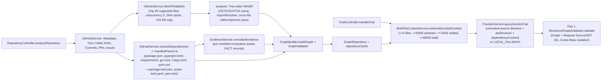

# ENGiTRACE AI IMPROVEMENT — PART 2 COMPREHENSIVE REPORT
# Repository Understanding, AST Analysis & Source-Code Intelligence

**Phase Completed:** Part 2 Only — Repository Understanding, AST Analysis & Source-Code Intelligence  
**Scope Integrity:** All Part 1 structured output validation, cross-repository evidence isolation, `FACT` / `INFERENCE` / `UNKNOWN` enforcement, and fallback defenses remain active and verified; vector-based RAG and Parts 3–5 were intentionally not implemented.  
**Core Architectural Principle:**  
> *Repository ingestion retrieves the actual source data. Deterministic parsers and graph algorithms extract engineering structure. Gemini explains the retrieved and validated context.*

---

## 1. Executive Summary & Historical Audit Verification

Before implementing Part 2, every historical gap listed in `docs/ENGITRACE_AI_ASSISTANT_AUDIT.md` was checked against the post-Part 1 repository state:

| Historical Audit Finding | Pre-Part 2 Verified Status | Part 2 Resolution |
| :--- | :--- | :--- |
| `GitHubService.extractDependencies()` returns hardcoded stub packages (`express`, `react`, `typescript`, `core-runtime`) | Still present in codebase | **Resolved** — Removed all stubs; replaced with deterministic manifest & lockfile parsing (`backend/src/services/manifestParser.ts`, `backend/src/services/githubService.ts`). |
| `analyzer/src/index.ts` is an unintegrated Phase 0 scaffold | Still present in codebase | **Resolved** — Replaced with a modular Tree-sitter WASM AST analyzer package (`analyzer/src/*`). |
| Tree-sitter AST analysis is not integrated | Still absent | **Resolved** — Integrated `web-tree-sitter@0.22.6` + `tree-sitter-wasms@0.1.13` across JS, TS, JSX, and TSX during ingestion and graph construction. |
| Source relationships rely partly on co-modification / filename guesses | Still present in `GraphBuilder` | **Improved** — Added deterministic AST `IMPORTS`, `DECLARES`, `EXPOSES`, `CALLS`, and component `CONTAINS` edges; suppressed heuristic `6.5b` co-modification `INFERENCE` edges whenever both files are AST-analyzed. |
| Chat retrieves only the single selected file capped at 50 KB | Still present in `ChatController` | **Resolved** — Added `MultiFileContextService` bounded multi-file retrieval (max 5 files, 50 KB selected, 15 KB/related file, 80 KB aggregate budget). |
| Chatbot lacks complete related imported/called source context | Still present | **Resolved** — Query-aware AST + graph neighborhood selection supplies imported modules, callers, callees, and manifests alongside `astStructure` and `dependencyContext`. |
| Full repository graph is not sent to Gemini | Intentional safeguard | **Preserved** — Gemini continues to receive bounded node neighborhoods and strictly bounded source snippets rather than unbounded full-repo dumps. |
| Part 1 `StructuredOutputValidator.validate`, repo isolation & fallback validation in `ChatController` | Resolved in Part 1 | **Preserved** — Extended cleanly so request-scoped `ev-src-*` and `ev-ast-*` evidence IDs validate alongside graph records while unretrieved/cross-repo IDs remain rejected. |

---

## 2. End-to-End Pipeline Architecture (Before vs. After)

### Before Part 2
- `GitHubService.extractDependencies` returned hardcoded sample npm/core packages rather than parsing repository files.
- `analyzer/src/index.ts` exported only a stub interface with mock counts and was not wired into `RepositoryController.analyzeRepository`.
- `GraphBuilder` created file/commit/PR/issue nodes, basic co-modification heuristics, and generic dependency nodes without multi-manifest provenance, ecosystem scoping, or AST symbol/call edges.
- `ChatController.handleChat` fetched only the single selected file (50 KB max) without importing neighboring files or AST call/import metadata.

### After Part 2



---

## 3. Dependency Manifest, Lockfile & Ecosystem-Aware Deduplication

Implemented in `backend/src/services/manifestParser.ts`, integrated into `backend/src/services/githubService.ts`, `backend/src/services/evidenceService.ts`, `graph-engine/src/builders/graphBuilder.ts`, and `backend/src/controllers/repositoryController.ts`.

### 3.1 Supported Manifest Parsers (`MANIFEST_PARSERS`)

| Ecosystem | Supported File Patterns | Parser / Library | Extracted Data & Classification |
| :--- | :--- | :--- | :--- |
| `npm` | Root & workspace `package.json` | Native `JSON.parse` (`packageJsonParser`) | Package name, declared version range, `dependencies`, `devDependencies`, `peerDependencies`, `optionalDependencies`, `workspaceName`, `sourceFile`. |
| `pip` | `requirements.txt`, `requirements-*.txt` | Line/continuation PEP 508 parser (`requirementsTxtParser`) | Package name, constraint (`==`, `>=`, etc.), dev classification for `requirements-dev*`/`test*` filenames, `-r` include skipping & comment stripping. |
| `pip` | `pyproject.toml` | `smol-toml@1.9.1` (`pyprojectTomlParser`) | PEP 621 `[project].dependencies`, `[project.optional-dependencies]`, Poetry `[tool.poetry.dependencies]` / `dev-dependencies` / `[tool.poetry.group.*.dependencies]` (excluding interpreter constraint `python`). |
| `go` | `go.mod` | Block & directive parser (`goModParser`) | Direct `require` directives separated from `// indirect` modules (placed in `transitiveDependencies`), module name as `workspaceName`. |
| `cargo` | `Cargo.toml` | `smol-toml@1.9.1` (`cargoTomlParser`) | `[dependencies]`, `[dev-dependencies]`, `[build-dependencies]`, `[workspace.dependencies]`, optional flags, git/path specifiers. |
| `maven` | `pom.xml` | `fast-xml-parser@5.12.0` (`pomXmlParser`) | `groupId:artifactId`, version + single-hop local `<properties>` substitution, `<scope>` mapping (`test`/`provided` -> `devDependencies`, `<optional>true</optional>` -> `optionalDependencies`). |

### 3.2 Lockfile Handling & Direct vs. Transitive Separation (`LOCKFILE_PARSERS`)
- **Supported Lockfiles:**
  - `package-lock.json` (v1 nested `dependencies` tree and v2/v3 `packages` map)
  - `pnpm-lock.yaml` (`yaml@2.9.1`, supporting `importers` and `packages` sections across lockfile formats)
  - `yarn.lock` (Yarn Classic v1 descriptor/version blocks + Yarn Berry YAML)
- **Strict Separation:**
  - **Direct dependencies** come exclusively from project manifests (`directDependencies`, `isDirect: true`). They preserve the manifest's `declaredVersion`, attach `resolvedVersion` and `lockfileSource` from the nearest directory/ancestor matching lockfile when available, and never invent a resolved version when absent.
  - **Transitive dependencies** extracted from lockfiles or Go `// indirect` lines are stored separately in `transitiveDependencies` (`summary.dependencyStats.transitiveCount`) and excluded from `summary.totalDependencies` and direct `DEPENDS_ON` graph edges.
- **Directory Skipping:** Ignores vendored/generated directories (`node_modules`, `.git`, `dist`, `build`, `coverage`, `.next`, `vendor`, `.venv`, `venv`, `target`).
- **Malformation & Empty States:** Malformed manifests or lockfiles record `status: 'MALFORMED'` with warning details without aborting sibling manifests; repositories with no supported manifests return `0` dependencies (no synthetic stubs).

### 3.3 Monorepo & Polyglot Ecosystem-Aware Graph Identity
- **Ecosystem-Aware Shared `DEPENDENCY` Node ID:** `GraphBuilder.getOrCreateDependencyNode` constructs canonical IDs as:
  ```text
  dependency:<ecosystem>:<packageName>
  ```
  (with matching `target` in `EvidenceService.normalizeEvidence` and lookup fallback in `ChatController.handleChat`).
  - **Monorepo Deduplication (Same Ecosystem):** When multiple `package.json` manifests declare the same package (e.g., `packages/web/package.json` declaring `react@^19.0.0` and `packages/admin/package.json` declaring `react@^18.2.0`), they link to one canonical `dependency:npm:react` node while recording all workspace declarations inside `node.metadata.declarations` and creating distinct per-manifest edges (`edge-dep-<ecosystem>-<manifest>-<category>-<pkg>`) and evidence records (`ev-dep-<ecosystem>-<manifest>-<category>-<pkg>`).
  - **Polyglot Collision Prevention (Cross-Ecosystem):** Same-named packages in different ecosystems (e.g., `npm` `redis` and `pip` `redis`) produce distinct nodes (`dependency:npm:redis` with npmjs reference vs. `dependency:pip:redis` with PyPI reference) and distinct evidence/counts (`uniqueDirectDependencies` keyed by `${d.ecosystem}:${d.name}` in `EvidenceService`).

---

## 4. Tree-sitter AST Source-Code Analyzer

Implemented as a standalone workspace module under `analyzer/src/` using pure WebAssembly (`web-tree-sitter@0.22.6` + `tree-sitter-wasms@0.1.13`), avoiding native Windows MSVC/node-gyp build requirements.

### 4.1 Language Registry & Grammar Support (`analyzer/src/languageRegistry.ts`, `treeSitterLoader.ts`)

| Language Key | Extensions | Grammar WASM |
| :--- | :--- | :--- |
| `javascript` | `.js`, `.mjs`, `.cjs` | `tree-sitter-javascript.wasm` |
| `jsx` | `.jsx` | `tree-sitter-javascript.wasm` |
| `typescript` | `.ts`, `.mts`, `.cts` | `tree-sitter-typescript.wasm` |
| `tsx` | `.tsx` | `tree-sitter-tsx.wasm` |

All other extensions return `status: 'UNSUPPORTED_LANGUAGE'` cleanly and are never claimed to have been AST-analyzed. WASM parse trees are freed deterministically inside `finally` blocks (`tree.delete()`).

### 4.2 Extracted Syntax, Resolution Rules & Limitations (`tsJsExtractor.ts`, `importResolver.ts`, `repositoryAnalyzer.ts`)
- **Extracted Constructs:**
  - ES & CommonJS imports (`import`, `import type`, side-effect imports, `require(...)`), export declarations (`named`, `default`, `reexport`, `commonjs`), functions, arrow functions, classes, methods, React/JSX function/arrow components (`jsxChildrenUsed`), interfaces, type aliases, parameters (with TS type annotations), and 1-based source line ranges.
- **Deterministic Import Resolution:** `resolveImportSpecifier` checks relative paths strictly against `repoFilePaths` (probing extensions `.ts`, `.tsx`, `.js`, `.jsx`, `.mts`, `.cts`, `.mjs`, `.cjs`, `.d.ts`, directory `/index.*`, and TypeScript ESM `.js -> .ts/.tsx/.d.ts` remapping while blocking `..` escapes above repo root). Specifiers are separated into:
  - `relative_internal` (`resolvedFilePath` populated only if present in `repoFilePaths`)
  - `external_package` (normalizes package / `@scope/pkg` name)
  - `alias_or_unresolved` (e.g., `@/...`, missing targets)
- **Conservative Cross-File Call & Component Resolution (`resolveCrossFileCallsAndComponents`):**
  - Resolves calls **only** when deterministically bound via:
    1. Same-file local symbol declarations (`local_symbol`)
    2. Explicit class `this.method()` within an enclosing class (`same_class_method`)
    3. Named/default or `Namespace.fn()` imports verified against an analyzed target file's declared symbols (`imported_symbol`)
  - Leaves dynamic expressions (`handlers[k]()`), unimported coincidental names (`ghostHelper()`), external packages, and unresolved member chains (`foo.bar()`) marked `resolved: false` (`unresolved_dynamic`, `unresolved_external`, `unresolved`).
  - Similarly resolves React `<ChildComponent />` JSX usage only when `<ChildComponent>` matches an imported/local component symbol.
- **Failure & Cap Statuses:** `ANALYZED`, `PARTIALLY_ANALYZED` (Tree-sitter syntax recovery with `parseErrorsCount > 0`), `PARSE_ERROR`, `SKIPPED_SIZE_LIMIT` (`DEFAULT_MAX_AST_FILE_BYTES = 120 KB`), and `UNSUPPORTED_LANGUAGE`.
- **Intentional Limitations:** Does not execute full TypeScript compiler type checking (`tsc` program), `tsconfig.json` `paths` alias mapping, dynamic `eval`/computed property dispatch, or non-JS/TS AST grammars (e.g., Python/Go/Rust AST).

---

## 5. Ingestion Orchestration, Caching & Rate-Limit Safeguards

Updated in `backend/src/services/githubService.ts` and `backend/src/controllers/repositoryController.ts`:
- **Tree SHA Preservation:** `GitHubService.fetchFileTree` and `fetchTopLevelContents` record Git blob `sha` on every `FileTreeItem`.
- **Bounded Batch Fetching (`GitHubService.fetchFilesBatch`):**
  - Enforces bounded worker concurrency (`concurrency` 5 for AST/manifests, 3 for lockfiles; clamped `<= 8`).
  - Pre-skips files exceeding byte limits (`120 KB` AST source limit; `256 KB` manifest limit; `2 MB` lockfile limit) before issuing network requests when `item.size` is known.
  - Deduplicates identical blob SHAs via `blobCache` (`sha:${item.sha}`).
  - Rejects path traversal (`..`, Windows drive paths) and binary extensions/null-byte content.
  - Stops queued fetches immediately once GitHub returns `429` or `403` with `X-RateLimit-Remaining: 0`, marking remaining items `rateLimited: true`.
- **AST Candidate Prioritization (`RepositoryController.analyzeRepository`):** Selects up to `60` supported source files, prioritizing files touched in recent commits, source roots (`src/`, `app/`, `lib/`, `packages/`, etc.), entry/service/controller paths, non-test files, and shallower depths.
- **Clean Re-Ingestion & Isolation:** Before saving a re-ingested snapshot and graph, stale keys in `repositoryCache` matching `metadata.id` or `metadata.name` are evicted and `GraphRepository.saveGraph` replaces only that repository's graph, preserving other cached repositories.

---

## 6. Engineering Memory Graph Schema, Directions & Downstream Compatibility

Updated in `graph-engine/src/models/graphModel.ts`, `graph-engine/src/relationships/relationshipRegistry.ts`, and `graph-engine/src/builders/graphBuilder.ts`:

- **Registered Canonical Relationships & Directions (`RelationshipRegistry`):**
  - `FILE ──[DEPENDS_ON]──→ DEPENDENCY | FILE`
  - `REPOSITORY | FILE | COMPONENT ──[CONTAINS]──→ FILE | COMPONENT`
  - `FILE ──[IMPORTS]──→ FILE`
  - `FILE ──[DECLARES]──→ FUNCTION | COMPONENT`
  - `FILE ──[EXPOSES]──→ FUNCTION | COMPONENT`
  - `FUNCTION | COMPONENT | FILE ──[CALLS]──→ FUNCTION | COMPONENT`
- **Node Types & Traceability:** Symbols emit `FUNCTION` (functions/methods) or `COMPONENT` (classes/React components) nodes with IDs `${type}:${repoId}:${filePath}:${qualifiedName}:${startLine}` and line-anchored `sourceReference` URLs (`#Lstart-Lend`). Interfaces and type aliases are attached to their enclosing `FILE` node's `metadata.interfaces` / `metadata.typeAliases`.
- **Heuristic Gating (`6.5a` & `6.5b`):**
  - `6.5a` skips filename-based test `DEPENDS_ON` heuristic edges if the test file already has a verified AST `IMPORTS` edge to that target.
  - `6.5b` skips commit co-modification `INFERENCE` `DEPENDS_ON` edges whenever both changed files were deterministically AST-analyzed (`astAnalyzedPaths`), eliminating spurious coupling edges between parsed TS/JS files while retaining fallback heuristics only for unanalyzed files.
- **Downstream Consumer Compatibility:**
  - `ImpactAnalysisService`: Added `DECLARES` alongside `CONTAINS` forward traversal so impacting a file includes its declared functions/components and downstream callers/importers.
  - `WhyExplorerService`: Extended `preferredTypesOrder` to prioritize `FILE`/`COMPONENT`/`FUNCTION`/history links for AST symbol queries.
  - `frontend/src/components/visualizations/DependencyExplorer.tsx`: Updated manifest path matching to recognize `pyproject.toml`, `pom.xml`, and `requirements*.txt` alongside `package.json`, `go.mod`, and `Cargo.toml`.

---

## 7. Bounded Multi-File Chat Retrieval, Security & Part 1 Validation Integration

Implemented in `backend/src/services/multiFileContextService.ts`, wired into `backend/src/controllers/chatController.ts` and `ai-engine/services/providerService.ts`:

- **Strict Retrieval Bounds (`MULTI_FILE_LIMITS`):**
  - `MAX_TOTAL_FILES = 5` (1 selected file + up to 4 related files)
  - `MAX_SELECTED_FILE_BYTES = 50 * 1024` (50 KB)
  - `MAX_RELATED_FILE_BYTES = 15 * 1024` (15 KB; uses centered line snippets around `focusLine` when larger)
  - `MAX_AGGREGATE_SOURCE_BYTES = 80 * 1024` (80 KB total payload across all included files)
  - `MAX_CANDIDATES_TO_ATTEMPT = 8`
- **Deterministic Query-Aware Candidate Selection:**
  - Combines AST relationships (`IMPORTS`, `CALLS`, reverse `IMPORTED_BY`, reverse `CALLED_BY`) and strictly same-repository `GraphRepository` neighborhood edges (`IMPORTS`, `CALLS`, `CONTAINS`, `DECLARES`, `EXPOSES`, `DEPENDS_ON`).
  - Boosts manifests (`package.json`, `pyproject.toml`, etc.) on dependency queries, reverse callers/importers on `WHAT_IF` impact queries, and direct imports/callees on implementation questions.
  - Records fetch failures/missing targets in `unavailableFiles` and budget/count-trimmed files in `omittedFiles` (never fabricating file contents).
- **Part 1 Validator & Prompt-Injection Preservation:**
  - Emits request-scoped `FACT` evidence records (`ev-src-selected-*`, `ev-src-rel-*`, `ev-ast-imp-*`, `ev-ast-call-*`) strictly bound to `canonicalRepoId` and merges them into `validationContext.evidence` passed to `StructuredOutputValidator.validate`.
  - Unretrieved, fabricated, or cross-repository evidence IDs remain rejected and downgraded to `UNKNOWN`.
  - `ProviderService.queryGeminiChat` instructs Gemini to treat `selectedNode.fileContent` and `relatedSourceFiles` strictly as untrusted data under analysis and ignore instructions inside comments/strings, while `ProviderService.generateLocalFallbackResponse` surfaces retrieved related files and `astStructure` summaries cleanly on `503`/`429` fallback.

---

## 8. Verification & Automated Regression Test Results

All build commands and all 13 test suites passed after the final code modification (`ecosystem-aware` `dependency:<ecosystem>:<name>` update, exit code `0`):

| Check | Command | Scope & Test Conditions | Result |
| :--- | :--- | :--- | :--- |
| Backend + Multi-Workspace TS Compile | `npm --prefix backend run build` (`tsc`) | Compiles `backend`, `analyzer`, `graph-engine`, `ai-engine`, and `backend/tests` cleanly (`strict: true`) | **Passed** (exit `0`) |
| Frontend Production Build | `npm --prefix frontend run build` (`tsc -b && vite build`) | Full TypeScript + Vite bundle (`1,661` modules, `2.74s`) | **Passed** (exit `0`) |
| Full Automated Test Runner (13 suites) | `npm --prefix backend test` | Hermetic offline execution; external GitHub & Gemini HTTP requests mocked deterministically where network calls occur | **Passed** (exit `0`, 13/13 suites) |

### Summary of Suites Executed in `npm --prefix backend test`
- **Pre-existing & Part 1 Suites (9 suites, all passed):**
  1. `tests/ingestion.test.ts` — URL normalization & Phase 1 evidence classification
  2. `tests/graph.test.ts` — `RelationshipRegistry`, `GraphBuilder` dedup, `GraphValidator`, `GraphQueryEngine`
  3. `tests/whyExplorer.test.ts` — WHY chain reconstruction & non-hallucination on unindexed nodes
  4. `tests/aiReasoning.test.ts` — Context builder, Part 4 validator, cache & fallback
  5. `src/__tests__/decisionDebt.test.ts` — Deterministic debt signals & summary
  6. `src/__tests__/impactAnalysis.test.ts` — Deterministic BFS traversal, scoring & directionality
  7. `tests/chatController.test.ts` — Parameter validation, WHY/commit/WHAT_IF routing & contradiction prevention
  8. `tests/chatRetriesAndFallback.test.ts` — Retry handling, Mermaid & unavailable-file `LOCAL_FALLBACK`
  9. `tests/chatValidationAndEvidence.test.ts` — Part 1 Tests 1–11 (evidence ID verification, downgrade to `UNKNOWN`, cross-repo isolation, malformed response defense, E2E mocked HTTP 200 & 503 fallback)
- **New Part 2 Suites (4 suites, all passed):**
  10. `tests/dependencyExtraction.test.ts` (`A1–A8`) — Root `package.json` 4-category extraction (no stubs), monorepo dual-version isolation, malformed manifest tolerance, zero-manifest empty result, `package-lock.json`/`pnpm-lock.yaml`/`yarn.lock` version resolution & direct-vs-transitive separation, Python/Go/Rust/Maven parsers, mocked `GitHubService.extractDependencies`, non-colliding `EvidenceService` monorepo IDs
  11. `tests/astAnalyzer.test.ts` (`B1–B10`) — Real Tree-sitter WASM parsing on TS, JS/CJS, JSX, TSX; React component parent/child composition; `this.method()` & imported cross-file calls vs. conservative restraint on dynamic/unimported calls; relative/ESM `.js -> .ts` import resolution vs. `@/` alias/missing target restraint; parse error / empty / unsupported / oversized isolation; `analyzeLocalRepository`
  12. `tests/part2GraphAndIngestion.test.ts` (`C1–C6`) — Monorepo `dependency:npm:react` dedup with multi-declaration preservation, AST `IMPORTS`/`DECLARES`/`EXPOSES`/`CALLS` edges + co-modification heuristic suppression, `ImpactAnalysisService` & `WhyExplorerService` over AST graph, mocked E2E `RepositoryController.analyzeRepository` + clean re-ingestion isolation, `C6` polyglot same-name separation (`dependency:npm:redis` vs. `dependency:pip:redis`)
  13. `tests/multiFileChatRetrieval.test.ts` (`D1–D8`) — Imported/called file retrieval, 5-file / 50 KB / 15 KB / 80 KB bounds + `omittedFiles`, dependency & impact query prioritization, `unavailableFiles` honesty, `ChatController` + Gemini mocked response (`ev-src-*` `FACT` accepted, unretrieved `ev-hacked` downgraded to `UNKNOWN`, untrusted-source prompt directive verified), cross-repo isolation, `503` grounded `LOCAL_FALLBACK`

---

## 9. Real Repository Ingestion Smoke Test (`unjs/destr`)

A live end-to-end smoke test was executed against public GitHub repository **`unjs/destr`** (`https://github.com/unjs/destr`, default branch `main`, at `2026-11-11T17:47:35Z`) invoking `RepositoryController.analyzeRepository`, `MultiFileContextService.retrieveBoundedContext`, and `ChatController.handleChat`.

### Environment & Auth Observations
- **GitHub Auth Fallback Exercised Real Production Code:** The pre-configured `GITHUB_TOKEN` in `backend/.env` returned `401 Unauthorized`; `GitHubService` logged the 401 and automatically fell back to unauthenticated GitHub REST access for public `unjs/destr` (`remaining=55/60` before run, `3/60` after run).
- **Gemini Key Auth Note:** Calling Google Gemini during `ChatController.handleChat` (`gemini-3.6-flash`) returned HTTP `401 AUTH_ERROR`. Per EngiTrace design, auth errors halted retries cleanly (`provider: "GEMINI_ERROR"`, `error: "GEMINI_AUTH_ERROR"`), leaving live Gemini generation unverified by this environment's expired `.env` credential.

### Live Observed Ingestion & Analysis Metrics (`unjs/destr`)
- **HTTP Response:** `200 OK` (`Repository analysis and Engineering Memory Graph construction complete`)
- **Retrieved Repository Metadata:** `id: "repo-unjs-destr"`, `language: "TypeScript"`, `filesCount: 25`, `commitsCount: 30`, `pullRequestsCount: 20`, `issuesCount: 1`
- **Live Manifest & Lockfile Parsing:**
  - Manifests: `package.json` (`status: "PARSED"`, `workspaceName: "destr"`, `dependenciesCount: 11` real `devDependencies` — e.g., `@hapi/bourne@^3.0.0`, `@vitest/coverage-v8@^3.2.4`, `typescript@^5.9.3`, `vitest@^3.2.4`, `unbuild@~3.6.1`, `secure-json-parse@^4.1.0`; zero stub packages injected).
  - Lockfiles: `pnpm-lock.yaml` (`status: "PARSED"`, `resolvedCount: 531`, `transitiveCount: 520`), resolving exact locked versions (e.g., `3.0.0`, `3.2.4`, `5.9.3`, `3.6.1`) onto direct declarations while isolating `520` transitive packages in `transitiveDependencies`.
- **Live Tree-sitter WASM AST Analysis:**
  - `6 / 6` supported JS/TS files analyzed cleanly (`status: "ANALYZED"`, `0` parse errors, `0` skipped): `src/index.ts` (TS, `5` symbols, `2` resolved internal calls), `test/index.test.ts` (TS, `1` resolved internal import -> `src/index.ts`, `26` resolved internal/method calls), `test/bench.mjs` (JS, `2` symbols, `6` resolved calls), `eslint.config.mjs` (JS), `lib/index.cjs` (JS), `deno.ts` (TS).
  - Totals: `totalSymbols: 7`, `totalImports: 10` (`1` resolved internal, `7` external, `2` unresolved), `totalCalls: 152` (`34` resolved, `118` conservatively left unresolved).
- **Constructed Engineering Memory Graph:**
  - `135` total nodes (`REPOSITORY: 1`, `FILE: 22`, `FUNCTION: 6`, `COMMIT: 31`, `PULL_REQUEST: 20`, `ISSUE: 28`, `DEPENDENCY: 11`, `AUTHOR: 16`)
  - `227` total edges (`CONTAINS: 22`, `PARENT_OF: 30`, `AUTHORED_BY: 51`, `MODIFIED: 52`, `REFERENCES: 24`, `RESOLVES: 11`, `DEPENDS_ON: 22`, `DECLARES: 6`, `EXPOSES: 2`, `IMPORTS: 1`, `CALLS: 6`; `193` `FACT`, `34` `INFERENCE`, `0` `UNKNOWN`)
- **Live Multi-File Chat Retrieval (`file:repo-unjs-destr:src/index.ts`):**
  - `MultiFileContextService` retrieved `src/index.ts` (`2,475` bytes) plus reverse-importer `test/index.test.ts` (`6,340` bytes; total `8,815` bytes, `2 / 5` files), populated `astHighlights` (`5` symbols, `4` exports, `2` resolved internal calls), emitted `+4 source/AST records` (`15` graph evidence records + `4` source/AST records logged in `ChatController`), and reported `unavailableCount: 2`, `omittedCount: 0`.

---

## 10. Known Limitations, Deferred Scope (Parts 3–5) & Modified Files Inventory

### Current Limitations (Part 2 Boundary)
- **Language Scope for AST:** Tree-sitter analysis covers `.js`, `.mjs`, `.cjs`, `.jsx`, `.ts`, `.mts`, `.cts`, `.tsx`. Manifest dependency extraction supports Python, Go, Rust, and Maven metadata, while source AST analysis does not yet parse non-JS/TS source files.
- **Static Resolution Conservatism:** Dynamic member dispatch, computed calls, `tsconfig.json` custom path aliases, and external library internals remain explicitly marked unresolved rather than guessed.
- **External API Credentials & Rate Limits:** Unauthenticated GitHub ingestion shares GitHub's 60 requests/hour IP quota; large repositories benefit from a valid `GITHUB_TOKEN`, and live Gemini synthesis requires a valid `GEMINI_API_KEY`.
- **Deferred Roadmap Scope (Not Modified in Part 2):** Parts 3–5 improvements (such as persistent database backing beyond `GraphRepository` in-memory storage, persistent chat memory, streaming responses, ADR Markdown directory scanning, or advanced multi-hop/workspace-wide AST indexing) remain intentionally out of scope.

### Modified & Created Files Inventory (Part 2)

| Status | File Path | Role in Part 2 |
| :--- | :--- | :--- |
| **Created** | `analyzer/src/types.ts` | AST result, import, export, symbol, call, and repository summary domain contracts |
| **Created** | `analyzer/src/languageRegistry.ts` | Extension-to-WASM grammar registry for JS, JSX, TS, TSX |
| **Created** | `analyzer/src/treeSitterLoader.ts` | Lazy WebAssembly loader & parser cache for `web-tree-sitter` and `tree-sitter-wasms` |
| **Created** | `analyzer/src/importResolver.ts` | Deterministic repository-verified relative/ESM/external/alias import resolver |
| **Created** | `analyzer/src/tsJsExtractor.ts` | Tree-sitter syntax extractor for imports, exports, symbols, parameters, JSX, calls & ranges |
| **Created** | `analyzer/src/repositoryAnalyzer.ts` | Single/multi-file/local analyzer + conservative second-pass cross-file call & component linker |
| **Modified** | `analyzer/src/index.ts` | Replaced Phase 0 stub exports with real Part 2 AST API |
| **Modified** | `backend/package.json` & `backend/package-lock.json` | Added `web-tree-sitter`, `tree-sitter-wasms`, `yaml`, `smol-toml`, `fast-xml-parser`; registered 4 Part 2 test scripts |
| **Modified** | `backend/src/types/evidence.ts` | Added blob `sha`, `DependencyCategory`, `DependencyExtractionResult`, `dependencyStats`, `astStats` |
| **Modified** | `frontend/src/types/evidence.ts` | Mirrored Part 2 summary & dependency contract fields |
| **Created** | `backend/src/services/manifestParser.ts` | Modular parsers for `package.json`, `requirements*.txt`, `pyproject.toml`, `go.mod`, `Cargo.toml`, `pom.xml`, and npm/pnpm/yarn lockfiles |
| **Modified** | `backend/src/services/githubService.ts` | Blob `sha` capture, real `extractDependencies`, `fetchFilesBatch` with concurrency/size/binary/SHA cache/rate-limit safeguards |
| **Modified** | `backend/src/services/evidenceService.ts` | Ecosystem-aware non-colliding `ev-dep-${ecosystem}-...` evidence records and provenance metadata |
| **Modified** | `graph-engine/src/models/graphModel.ts` | Added AST/dependency metadata fields on `GraphNodeMetadata` |
| **Modified** | `graph-engine/src/relationships/relationshipRegistry.ts` | Registered `IMPORTS`, `CALLS`, `DECLARES`, `EXPOSES`; updated `CONTAINS` & `DEPENDS_ON` node allowances |
| **Modified** | `graph-engine/src/builders/graphBuilder.ts` | Ecosystem-aware shared `dependency:<ecosystem>:<name>` nodes, per-manifest edges, AST symbol/call/import integration, `6.5a`/`6.5b` heuristic gating |
| **Modified** | `backend/src/controllers/repositoryController.ts` | Bounded top-60 source retrieval, AST execution, summary stats, snapshot storage & clean re-ingestion eviction |
| **Modified** | `backend/src/services/impactAnalysisService.ts` | Added `DECLARES` traversal alongside `CONTAINS` |
| **Modified** | `backend/src/services/whyExplorerService.ts` | Included `FUNCTION` and `COMPONENT` traversal priorities |
| **Created** | `backend/src/services/multiFileContextService.ts` | Bounded multi-file chat retrieval, query-aware ranking, and scoped `FACT` evidence emission |
| **Modified** | `backend/src/controllers/chatController.ts` | Wired `MultiFileContextService`, `astStructure`, `dependencyContext`, and ecosystem-aware dependency matching with Part 1 validator preserved |
| **Modified** | `ai-engine/services/providerService.ts` | Untrusted-source prompt-injection directive + multi-file/AST context integration in prompts & local fallback |
| **Modified** | `frontend/src/components/visualizations/DependencyExplorer.tsx` | Added `pyproject.toml`, `pom.xml`, and `requirements*.txt` manifest detection |
| **Created** | `backend/tests/dependencyExtraction.test.ts` | Part 2 Group A regression suite (`A1–A8`) |
| **Created** | `backend/tests/astAnalyzer.test.ts` | Part 2 Group B regression suite (`B1–B10`) |
| **Created** | `backend/tests/part2GraphAndIngestion.test.ts` | Part 2 Group C regression suite (`C1–C6`) |
| **Created** | `backend/tests/multiFileChatRetrieval.test.ts` | Part 2 Group D regression suite (`D1–D8`) |
| **Created/Updated** | `docs/ENGITRACE_AI_IMPROVEMENT_PART_2_REPORT.md` | Full Part 2 engineering & verification report |
