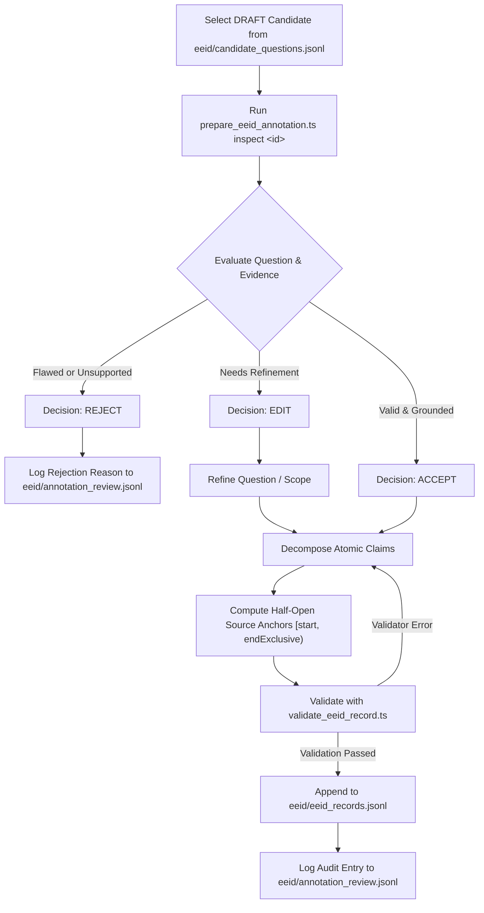

# EngiTrace EEID — Human Annotation Guide and Standard Operating Procedure (SOP)

## 1. Overview and Core Principles

The **EngiTrace Engineering Intelligence Dataset (EEID)** is a rigorous benchmark designed to evaluate code reasoning agents on real-world engineering questions across architecture, dependencies, history, and impact analysis.

### The Cardinal Rule of EEID Annotation
> [!IMPORTANT]
> **Automatically generated questions must never become VERIFIED ground-truth records without human review.**
> AI assistance may be used to identify candidate topology and assemble source indices, but every claim, source anchor, graph path, and ground-truth answer must be reviewed, verified, and adjudicated by a qualified engineer.

### Dataset Statuses
- `DRAFT`: Generated by candidate selection algorithms. Unverified. Never used in evaluation.
- `IN_REVIEW`: Assigned to an annotator and currently under review.
- `VERIFIED`: Human-reviewed, claim-decomposed, source-anchored, and passed strict automated validator checks.
- `REJECTED`: Candidate rejected due to flawed premises, ambiguous wording, or lack of grounded evidence.

---

## 2. The Six EEID Question Categories

Every EEID record belongs to exactly one category:

### 1. `NODE_UNDERSTANDING`
- **Objective**: Evaluates an agent's comprehension of an isolated code symbol (function, method, class, component, file, or dependency).
- **Core Inquiries**: What is the purpose of this node? What are its input parameters, return values, preconditions, side effects, and lifecycle invariants?
- **Interaction Mode**: `NODE_INTELLIGENCE`
- **Multi-File / History**: Typically single-file (`requiresMultiFile: false`, `requiresHistory: false`).

### 2. `HISTORICAL_REASONING`
- **Objective**: Evaluates reasoning over git commits, pull requests, issues, and changelogs.
- **Core Inquiries**: What changed in commit $X$? What problem was reported in issue $Y$? What documented rationale is recorded in the PR discussion or changelog?
- **Interaction Mode**: `REPO_CONVERSATION` or `NODE_INTELLIGENCE`
- **Multi-File / History**: `requiresHistory: true`.
- **Temporal Invariant**: Cites only information available *at or before* the repository snapshot timestamp. Never leak post-snapshot events or speculate beyond documented evidence.

### 3. `DEPENDENCY_INTELLIGENCE`
- **Objective**: Evaluates understanding of verified static relationships (caller-callee hierarchies, module imports, external package declarations).
- **Core Inquiries**: Which functions directly call $F$? Trace the static call path from $A$ to $B$. What dependencies does module $M$ consume?
- **Interaction Mode**: `NODE_INTELLIGENCE`
- **Strict Rule**: Only cite *verified* AST relationships present in `edges.jsonl`. Never invent relationships for unresolved dynamic calls.

### 4. `IMPACT_ANALYSIS` (WHAT IF Scenarios)
- **Objective**: Evaluates counterfactual reasoning when a component is modified, removed, replaced, or deprecated.
- **Core Inquiries**: WHAT IF function $F$ is modified to return a Promise? What if dependency $D$ is removed?
- **Interaction Mode**: `WHAT_IF`
- **Ground Truth**: Requires a structured `whatIfGroundTruth` block containing operation, blast-radius score, directly affected nodes, indirectly affected nodes, verified dependency paths, static certainties, and runtime uncertainties.

### 5. `REPOSITORY_CONVERSATION`
- **Objective**: Evaluates multi-file architectural synthesis across multiple modules.
- **Core Inquiries**: How do files $A$, $B$, and $C$ collaborate to implement a feature? Explain the end-to-end request flow.
- **Interaction Mode**: `REPO_CONVERSATION`
- **Multi-File Invariant**: `requiresMultiFile: true`. Must cite evidence from at least **two distinct files**.

### 6. `EVIDENCE_AND_UNCERTAINTY`
- **Objective**: Evaluates the agent's ability to recognize missing evidence, undocumented rationale, or non-existent symbols without hallucinating answers.
- **Core Inquiries**: Does the repository index contain documentation explaining why constant $K$ was chosen? Does class $C$ provide method $M$?
- **Grounding Rule**: The absence of evidence must be verified against the index. Record the exact search scope and indexed file set.

---

## 3. Atomic Claim Decomposition

An EEID ground-truth answer is not an unstructured block of text. It must be decomposed into a list of **atomic claims** (`expectedClaims`).

### Principles of Atomicity
1. **Single Testable Assertion**: Each claim must make exactly one factual, inferential, or uncertainty assertion.
2. **Decompose Conflated Premises**:
   - *Bad (Conflated)*: "authenticate() accepts username and password, verifies them against user.salt using pbkdf2, and the database should be upgraded in production."
   - *Good (Atomic)*:
     - Claim 1 (FACT): "`authenticate(name, pass, fn)` accepts a username, password, and callback function."
     - Claim 2 (FACT): "The function queries an in-memory `users` dictionary and computes a hash using `pbkdf2-password`."
     - Claim 3 (INFERENCE): "The in-memory dictionary is an illustrative mock and unsuitable for production persistence."

---

## 4. Claim Classification: FACT, INFERENCE, and UNKNOWN

| Classification | Definition | Mandatory Fields | Allowed Confidence Tiers |
|---|---|---|---|
| **`FACT`** | Direct, indisputable statement directly stated in indexed source code, manifest, or commit metadata. | `evidenceIds` (non-empty), `sourceAnchors` (non-empty with valid hash) | `DEFINITIVE`, `HIGH` |
| **`INFERENCE`** | Logical deduction, architectural interpretation, or best-practice conclusion derived from facts or comments. | `evidenceIds` (non-empty), `reasoning` (explicit string explanation) | `HIGH`, `SPECULATIVE` |
| **`UNKNOWN`** | Explicit statement that requested information is missing, unindexed, or unverifiable. | `evidenceIds` (scope where info was sought) | `ABSENT`, `SPECULATIVE` *(Never `DEFINITIVE`)* |

---

## 5. Source Anchors and the Half-Open Interval Convention

Every `FACT` claim tied to source code must declare at least one `SourceAnchor`.

### The Half-Open Interval Rule: `[start, endExclusive)`
- `sourceLineStart`: 1-based line number of the first included line (inclusive).
- `sourceLineEndExclusive`: 1-based line number of the line immediately following the last included line (exclusive).
- **Formula**: The slice consists of lines $L$ where $\text{sourceLineStart} \le L < \text{sourceLineEndExclusive}$.
- **Example**: To anchor lines 60 through 73 (14 lines total):
  - `sourceLineStart`: `60`
  - `sourceLineEndExclusive`: `74`
  - Interval: `[60, 74)`

### Content Hash Invariant
The `contentHash` must be the exact SHA-256 hex digest of the normalized lines joined with newline `\n`:
$$\text{contentHash} = \text{SHA-256}\left(\sum_{i=\text{start}}^{\text{endExclusive}-1} \text{Line}_i\right)$$
The automated record validator recomputes this hash from the repository snapshot. Any discrepancy will fail validation.

---

## 6. Graph Path Traversal Rules for WHAT IF Scenarios

For `IMPACT_ANALYSIS`, every dependency path in `whatIfGroundTruth.dependencyPaths` must conform to:
1. **Odd-Length Sequence**: `[node0, edge0, node1, edge1, node2, ...]`.
2. **Endpoint Continuity**: Each edge must genuinely link the previous node to the next node in `edges.jsonl`.
3. **Target Binding**: At least one endpoint (start or end) must connect to `targetNode.id` or `directlyAffectedNodeIds`.
4. **Blast Radius Score**: A deterministic percentage $(0 \text{ to } 100)$ reflecting the proportion of dependent nodes affected.
5. **Certainty Separation**:
   - `staticCertainty`: Call sites, direct imports, and compiler type constraints verified by static analysis.
   - `runtimeUncertainties`: Dynamic dispatch, monkey-patching, runtime configuration, and plugin hooks that cannot be statically guaranteed.

---

## 7. Rejection Criteria

Annotators must **REJECT** a candidate question if:
1. **Hallucinated Premise**: The question asks about behavior or code that does not exist in the repository.
2. **Ambiguous Phrasing**: The question is vague or can be interpreted in multiple conflicting ways.
3. **Temporal Violation**: The question relies on pull requests, issues, or commits created after the snapshot cutoff.
4. **Insufficient Evidence**: The repository index does not contain sufficient code chunks or documentation to establish ground truth.
5. **Unresolved Target Node**: The target node ID is missing from `nodes.jsonl`.

When rejecting, the annotator must record an explicit rejection category and explanatory notes in `eeid/annotation_review.jsonl`.

---

## 8. Step-by-Step Annotator Workflow



### Review Commands Quick Reference
```bash
# 1. Prepare review dossier queue for all 30 candidates
node backend/node_modules/tsx/dist/cli.mjs prepare_eeid_annotation.ts --prepare

# 2. Inspect candidate dossier
node backend/node_modules/tsx/dist/cli.mjs prepare_eeid_annotation.ts --inspect EEID-CAND-001-NODE-0001

# 3. Apply human review decision (ACCEPT, EDIT, or REJECT)
node backend/node_modules/tsx/dist/cli.mjs prepare_eeid_annotation.ts --apply-pilot-batch

# 4. Validate resulting EEID verified records
node backend/node_modules/tsx/dist/cli.mjs validate_eeid_record.ts --file eeid/eeid_records.jsonl
```

